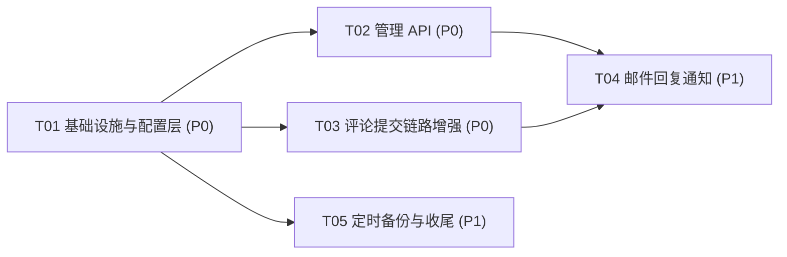
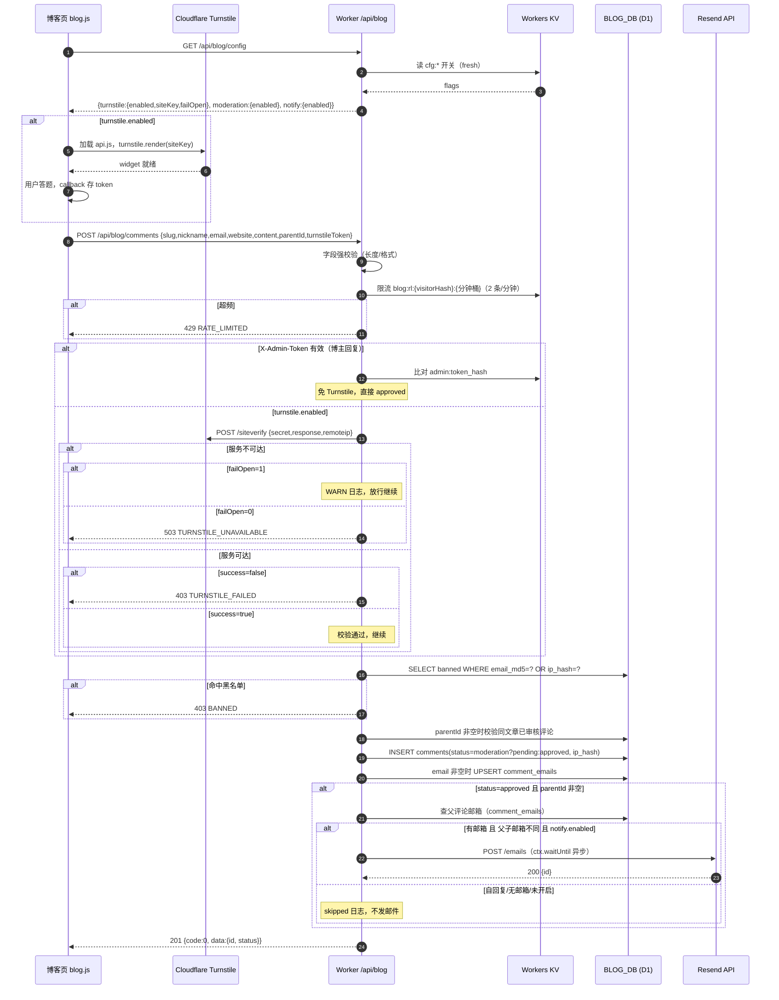
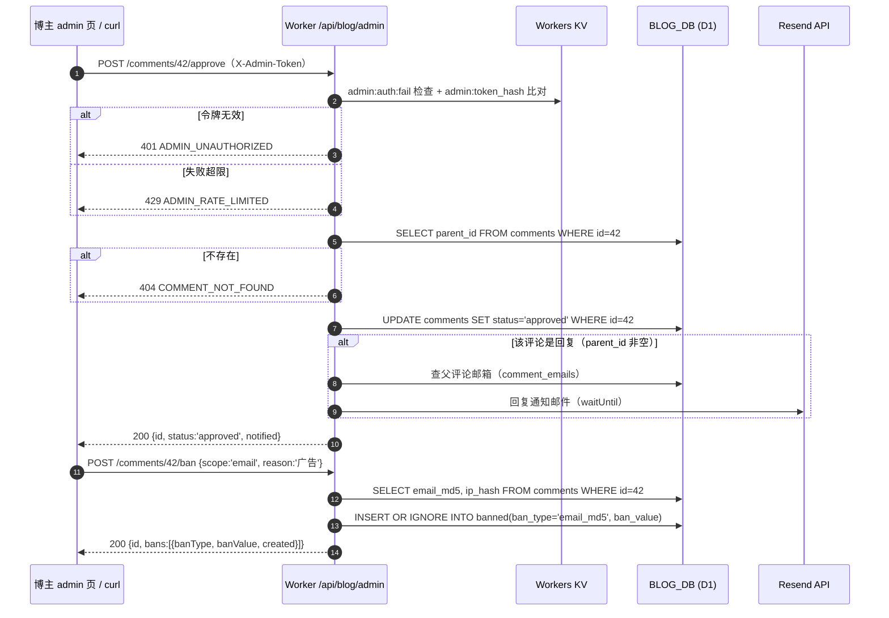
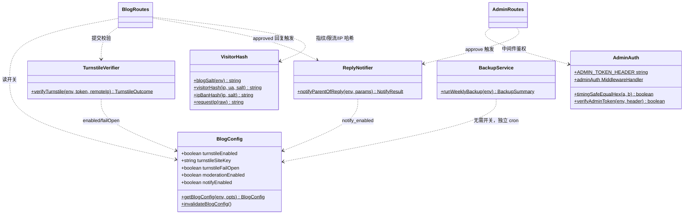

# 渡劫code T04 评论系统增强 — 增量设计文档

| 项 | 值 |
|---|---|
| 文档 ID | ARCH-T04-COMMENT-ADMIN-2026-10-21 |
| 作者 | 高见远（架构师） |
| 日期 | 2026-10-21 |
| 类型 | **增量设计**（不改写既有架构，只描述 T04 变更面） |
| 对应路线图 | `docs/ARCHITECTURE-ROADMAP-2026-10-21.md` §T04（P1，4.0 人日，依赖 T01） |
| 基线事实 | `worker/index.ts`（379 行）、`worker/routes/blog.ts`（485 行）、`schema-blog.sql`、`wrangler.toml`（已核实，本文直接引用行级行为） |
| 工作量映射 | T01=1.0 / T02=1.0 / T03=1.0 / T04=0.5 / T05=0.5 人日 |

## 0. 增量总览（一页看懂）

**改动面**（全部限于本仓库 Worker；博客前端仓库改动见 §7-T03/T05 协调项）：

- `worker/index.ts`：4 处小改（requestId 注入上下文、CORS 放行 `X-Admin-Token`、AUTH_EXEMPTIONS +1 条、authMiddleware 对 `/api/blog/admin/` 前缀放行）+ 挂载 admin 路由 + 新增 `scheduled` handler。
- `worker/routes/blog.ts`：重写 `POST /comments` 一个 handler（链路加 Turnstile→黑名单→审核状态→通知）；新增 `GET /config`；`visitorHash` 迁移到 lib。
- 新建 6 个 Worker 文件：`worker/lib/config.ts`、`worker/lib/visitor.ts`、`worker/lib/turnstile.ts`、`worker/lib/notify.ts`、`worker/lib/backup.ts`、`worker/middleware/admin-auth.ts`、`worker/routes/admin.ts`（7 个）。
- 数据层：只加表、加列、加索引（幂等）；存量数据不动。
- 配置：`wrangler.toml` 加 `[triggers] crons` + 3 个 vars；2 个 secrets + 6 个 KV 开关键（人工一次性设置，见 §6）。

**核心设计决策**（详细论证见对应章节）：

| # | 决策 | 结论 |
|---|---|---|
| D1 | 管理 API 鉴权 | **X-Admin-Token 头 + KV 存 SHA-256 比对**（不复用 JWT 用户体系）——§2.1 |
| D2 | Turnstile 失败降级 | 校验结论失败 → 拒绝；**服务不可达 → 放行**（fail-open，KV 开关可关）——§3.4 |
| D3 | 审核队列开关 | KV `cfg:moderation_enabled`，默认 `0`（全 approved 双跑），灰度后置 `1`——§6 |
| D4 | 回复通知邮箱存储 | 新表 `comment_emails` 单独存明文邮箱，**不破坏 comments 只存 md5 的隐私契约**——§1.4 |
| D5 | 博主回复通道 | 公开 `POST /comments` 带有效 `X-Admin-Token` → 免 Turnstile、直接 approved——§2.2 |

---

## 1. 增量 Schema

### 1.1 `comments.status` 语义扩展

| 值 | 语义 | 谁写入 | 公开可见 |
|---|---|---|---|
| `approved` | 已审核，公开展示（存量语义，不变） | 默认；博主提交；管理审核通过 | 是 |
| `pending` | 待审核，不展示（**新增**） | 审核队列开启后的访客提交 | 否 |
| `hidden` | 已隐藏/软删除，不展示（**新增**） | 管理后台「隐藏」操作 | 否 |

约束说明：
- **不加 CHECK 约束**：SQLite/D1 无法对已存在表追加列级约束；由应用层白名单校验（管理 API 的 status 过滤参数、写入时的字面量均为代码内常量，无用户输入直通）。
- 公开查询（`GET /comments`、`GET /stats`、parent 校验）已全部带 `status='approved'` 过滤，**pending/hidden 天然不可见，无需改查询**。
- 存量行全部为 `approved`，无数据迁移。

### 1.2 `comments` 新增列：`ip_hash`

- 用途：IP 维度拉黑（ banned 表 `ip_hash` 类型）+ 管理列表溯源。
- 定义：`ip_hash = sha256Hex(CF-Connecting-IP + "|ipban|" + BLOG_SALT)`，64 位小写 hex。与既有 `visitorHash`（含 UA，用于限流/点赞去重）**刻意不同**：换 UA 不能绕开 IP 黑名单。
- DDL：`ALTER TABLE comments ADD COLUMN ip_hash TEXT`（SQLite 不支持 `ADD COLUMN IF NOT EXISTS，见 §1.6 守卫脚本）。
- 存量回填：`UPDATE comments SET ip_hash = '' WHERE ip_hash IS NULL`（幂等，可重复执行）。

### 1.3 新表 `banned`（黑名单）

```sql
CREATE TABLE IF NOT EXISTS banned (
  id INTEGER PRIMARY KEY AUTOINCREMENT,
  ban_type TEXT NOT NULL,            -- 'email_md5' | 'ip_hash'
  ban_value TEXT NOT NULL,           -- email_md5(32hex) 或 ip_hash(64hex)
  reason TEXT DEFAULT '',            -- 拉黑原因（管理员填写，可空）
  created_at TEXT DEFAULT (datetime('now'))
);
CREATE UNIQUE INDEX IF NOT EXISTS idx_banned_unique ON banned(ban_type, ban_value);
CREATE INDEX IF NOT EXISTS idx_banned_type ON banned(ban_type);
```

- `UNIQUE(ban_type, ban_value)`：同一对象重复拉黑走 `INSERT OR IGNORE`，天然幂等；解除拉黑 = `DELETE`。
- 查询模式（每次提交评论）：`WHERE (ban_type='email_md5' AND ban_value=?) OR (ban_type='ip_hash' AND ban_value=?)`，两条索引均可命中。
- **不做过期时间**：个人博客黑名单量级 ≤ 百行，手动管理足够；如未来需要，加列即可（不属本期）。

### 1.4 新表 `comment_emails`（回复通知邮箱，D4）

```sql
CREATE TABLE IF NOT EXISTS comment_emails (
  comment_id INTEGER PRIMARY KEY,
  email TEXT NOT NULL,
  created_at TEXT DEFAULT (datetime('now'))
);
```

- 动机：`comments` 表现行只存 `email_md5`（Gravatar 用，不返回前端），这是既有隐私契约；「回复邮件通知」必须拿到被回复者的明文邮箱。单独建表使明文邮箱**隔离存放、可独立 purge、不进任何公开查询**。
- 写入时机：`POST /comments` 且 `email !== ''` 时 `INSERT OR REPLACE`（一条评论一行）。
- 读取时机：仅 `notify.ts` 与管理后台列表（脱敏显示 `a***@b.com`）。
- 删除联动：管理删除评论时同步删（见 §2.3 DELETE）。

### 1.5 新增索引（管理列表）

```sql
CREATE INDEX IF NOT EXISTS idx_comments_status_created ON comments(status, created_at DESC, id DESC);
CREATE INDEX IF NOT EXISTS idx_comments_parent ON comments(parent_id);
```

- `idx_comments_slug(slug, status, created_at)` 已存在，公开查询继续复用，不动。
- `idx_comments_status_created` 服务管理后台按 status 分页；`idx_comments_parent` 服务回复数统计/通知查父。

### 1.6 迁移执行（幂等，一次性）

**文件 1：`schema-t04.sql`（仓库根，可重复执行）**

```sql
-- T04 增量 schema（幂等：CREATE IF NOT EXISTS + WHERE IS NULL，重复执行安全）
CREATE TABLE IF NOT EXISTS banned ( ... );            -- 同 §1.3
CREATE UNIQUE INDEX IF NOT EXISTS idx_banned_unique ON banned(ban_type, ban_value);
CREATE INDEX IF NOT EXISTS idx_banned_type ON banned(ban_type);
CREATE TABLE IF NOT EXISTS comment_emails ( ... );    -- 同 §1.4
CREATE INDEX IF NOT EXISTS idx_comments_status_created ON comments(status, created_at DESC, id DESC);
CREATE INDEX IF NOT EXISTS idx_comments_parent ON comments(parent_id);
UPDATE comments SET ip_hash = '' WHERE ip_hash IS NULL;   -- 存量兜底
```

**文件 2：`scripts/migrate-t04.mjs`（ALTER 守卫，Node 内置模块，零新依赖）**

```js
// 用法：node scripts/migrate-t04.mjs            # 默认 --remote
// 背景：SQLite 的 ALTER TABLE ADD COLUMN 无 IF NOT EXISTS，重复执行会报错，
//       故先用 PRAGMA table_info 守卫，再执行 schema-t04.sql。
import { execSync } from 'node:child_process'
const DB = 'gjsvip-blog-db'
const run = (cmd) => execSync(cmd, { encoding: 'utf8', stdio: ['ignore', 'pipe', 'inherit'] })

const info = JSON.parse(run(`wrangler d1 execute ${DB} --remote --json --command "PRAGMA table_info(comments)"`))
const hasIpHash = info[0].results.some((col) => col.name === 'ip_hash')
if (hasIpHash) {
  console.log('[migrate] comments.ip_hash 已存在，跳过 ALTER')
} else {
  run(`wrangler d1 execute ${DB} --remote --command "ALTER TABLE comments ADD COLUMN ip_hash TEXT"`)
  console.log('[migrate] 已添加 comments.ip_hash')
}
run(`wrangler d1 execute ${DB} --remote --file=schema-t04.sql`)
console.log('[migrate] schema-t04.sql 应用完成')
```

> **纪律**（承接路线图 §6）：执行迁移前先跑一次数据导出（T05 就绪前可 `wrangler d1 export gjsvip-blog-db --remote --output=backup-pre-t04.sql`）。迁移为人工一次性动作，CI 不自动执行。

---

## 2. API 契约

### 2.1 管理 API 鉴权方案选型（决策 D1）

**推荐：独立 `X-Admin-Token` 请求头 + KV 哈希比对。**

| 维度 | 方案 A：X-Admin-Token + KV（**推荐**） | 方案 B：复用 JWT 用户 + 角色 |
|---|---|---|
| 适配场景 | 管理员=博主一人，无角色体系诉求 | 多管理员、分级权限 |
| 改造面 | 新增 1 个中间件（~50 行）+ 1 个 KV 键 | 需 users 表加 role、JWT claims 扩展、登录态打通 |
| 对现有系统风险 | **零**（不碰 `dj_session`/session KV/users 表） | 中（改鉴权主链路，影响全部用户端点） |
| 前端适配 | 博客静态站无 cookie 会话，header 直插即可（curl 可调试） | 静态站需先登录拿 cookie，流程重 |
| 轮换成本 | 1 条 KV put | 需改 JWT 签发逻辑 + 全量会话失效 |
| 安全强度 | 32 字节随机 token（~2^256 搜索空间），KV 只存 SHA-256，常量时间比对，失败限流 | 同级但过度设计 |

**结论**：单人管理场景下方案 A 是正确粒度；方案 B 的设施（角色表、claims）在 T04 没有任何第二个消费者，属纯粹负债。

**Token 机制**（`worker/middleware/admin-auth.ts`）：

```ts
export const ADMIN_TOKEN_HEADER = 'X-Admin-Token'
const KV_TOKEN_HASH_KEY = 'admin:token_hash'   // 值 = sha256Hex(token)，64hex
const MAX_FAILS = 5                            // 失败限流：5 次 / 5 分钟 / IP
const FAIL_TTL_SEC = 300

export function timingSafeEqualHex(a: string, b: string): boolean {
  if (a.length !== b.length) return false
  let diff = 0
  for (let i = 0; i < a.length; i++) diff |= a.charCodeAt(i) ^ b.charCodeAt(i)
  return diff === 0
}

export async function verifyAdminToken(env: Env, header: string | undefined): Promise<boolean> {
  if (header === undefined || header.trim() === '') return false
  const stored = await env.KV.get(KV_TOKEN_HASH_KEY)
  if (stored === null) return false
  return timingSafeEqualHex(await sha256Hex(header.trim()), stored.trim())
}

// Hono 中间件：挂载于 admin 路由组（adminRoutes.use('*', adminAuth)）
export const adminAuth: MiddlewareHandler<AppEnv> = async (c, next) => {
  const ipBan = await ipBanHash(requestIp(c.req.raw), blogSalt(c.env))
  const failKey = `admin:auth:fail:${ipBan}`
  const used = Number.parseInt((await c.env.KV.get(failKey)) ?? '0', 10)
  if (used >= MAX_FAILS) {
    return c.json({ code: 'ADMIN_RATE_LIMITED', message: '失败次数过多，请 5 分钟后再试' }, 429)
  }
  const ok = await verifyAdminToken(c.env, c.req.header(ADMIN_TOKEN_HEADER))
  if (!ok) {
    await c.env.KV.put(failKey, String(used + 1), { expirationTtl: FAIL_TTL_SEC })
    return c.json({ code: 'ADMIN_UNAUTHORIZED', message: '管理令牌无效' }, 401)
  }
  await next()
}
```

**Token 初始化（人工一次性，写入 runbook）**：

```bash
TOKEN=$(openssl rand -base64 32 | tr -d '/+=' | head -c 32)
wrangler kv key put --binding=KV --namespace-id=1c168f5887d5457b8fa456084c9ca4b1 \
  admin:token_hash "$(printf '%s' "$TOKEN" | sha256sum | cut -d' ' -f1)"
# TOKEN 交给博主保存（密码管理器）；丢失 = 重走上面两步换新 token
```

**与全局 JWT 中间件的衔接**（`worker/index.ts` authMiddleware 内，`if (!c.req.path.startsWith('/api/') || isAuthExempt(c))` 判断之后插入）：

```ts
// 管理 API 自带 X-Admin-Token 鉴权（routes/admin.ts 的 adminAuth），不占用用户会话
if (c.req.path.startsWith('/api/blog/admin/')) {
  await next()
  return
}
```

> 说明：`isAuthExempt` 是 method+path 精确匹配（路线图 F09 写的 `/api/admin/*` 通配不可行，管理路径带 `:id` 动态段），故用前缀放行 + 路由级中间件承接，语义等价且不漏放。

### 2.2 公共端点变更

#### GET /api/blog/config（新增，公开）

- 鉴权：无（`AUTH_EXEMPTIONS` 增加 `{ method: 'GET', path: '/api/blog/config' }`）。
- 用途：前端灰度开关的唯一数据源（Turnstile 渲染、pending 提示）。
- 处理：`getBlogConfig(c.env, { fresh: true })`（绕过 60s 缓存，管理页可见即时值）。
- 响应 `200`：

```json
{ "code": 0, "data": {
  "turnstile": { "enabled": false, "siteKey": "", "failOpen": true },
  "moderation": { "enabled": false },
  "notify": { "enabled": true }
} }
```

- 附带响应头 `Cache-Control: public, max-age=60`。
- 错误：无业务错误（KV 异常时按默认值降级并 WARN 日志，不 500）。

#### POST /api/blog/comments（变更，公开）

- 新增请求字段：`turnstileToken?: string`（≤2048；Turnstile widget 回调取得的 token）。
- 新增可选请求头：`X-Admin-Token`（博主从公开表单回复时使用；无效值按匿名忽略，不报错、不泄露）。
- 响应变更：`201 {code:0, data:{ id, status }}`（**新增 `status` 字段**，旧前端读 `id` 不受影响；新前端据 `status==='pending'` 提示「已提交，待审核后展示」）。

**完整处理链**（重写后的 handler，顺序即防线顺序）：

```
1.  解析 JSON + 字段强校验（既有逻辑不变：slug/nickname/email/website/content/parentId）
2.  adminTokenValid = await verifyAdminToken(env, header('X-Admin-Token'))   // 无头/无效 → false
3.  限流（既有）：KV blog:rl:{visitorHash}:{分钟桶}，2 条/分钟 → 429 RATE_LIMITED
4.  Turnstile（skip if adminTokenValid || !turnstile.enabled）：
      token 缺失        → 400 TURNSTILE_TOKEN_MISSING
      success=false     → 403 TURNSTILE_FAILED
      服务不可达 + failOpen=1  → WARN 日志，放行（决策 D2）
      服务不可达 + failOpen=0  → 503 TURNSTILE_UNAVAILABLE
      secret 未配置     → WARN 日志，放行（部署先于 secret 的灰度态）
5.  黑名单（新增）：
      email !== '' 时查 banned(email_md5=md5(email))
      恒查 banned(ip_hash=ipBanHash(ip))
      命中 → 403 BANNED（message 不带原因细节）
      （空邮箱用户只受 IP 黑名单约束：派生 md5 随「昵称:文章」变化，拉黑无意义，刻意跳过）
6.  parentId 校验（既有）：必须指向同文章 approved 评论 → 400 BAD_PARENT
7.  status = (adminTokenValid || !moderation.enabled) ? 'approved' : 'pending'   // 决策 D3/D5
8.  KV 限流计数 +1（既有，注意：步骤 3 读、此处写，位置不变）
9.  INSERT INTO comments (slug,parent_id,nickname,email_md5,website,content,status,ip_hash)
10. email !== '' → INSERT OR REPLACE INTO comment_emails(comment_id, email)
11. parentId !== null && status === 'approved'
      → c.executionCtx.waitUntil(notifyParentOfReply(env, {...}))   // 异步，绝不阻塞响应
12. 201 {code:0, data:{id, status}}
```

### 2.3 管理端点（`worker/routes/admin.ts`，挂载于 `/api/blog/admin`，全部经 `adminAuth`）

统一约定：成功 `{code:0, data}`；失败 `{code, message}`；分页参数 `page≥1`（默认 1）、`page_size∈[1,100]`（默认 20）。

#### ① GET /api/blog/admin/comments — 评论列表

- Query：`slug?`（≤100）、`status?`（`approved|pending|hidden`）、`q?`（≤50，匹配 nickname/content，`LIKE %q% ESCAPE '\'`）、`page`、`page_size`。
- SQL：`comments LEFT JOIN comment_emails`，`WHERE (? IS NULL OR slug=?) AND (? IS NULL OR status=?) AND (? IS NULL OR (nickname LIKE ? OR content LIKE ?)) ORDER BY created_at DESC, id DESC LIMIT ? OFFSET ?`；另发一条同 WHERE 的 `COUNT(*)`。
- 响应 `200`：

```json
{ "code": 0, "data": {
  "items": [{ "id": 42, "parentId": 7, "slug": "cf-worker-comment", "nickname": "张三",
              "emailMasked": "z***@qq.com", "website": "", "content": "写得好",
              "status": "pending", "createdAt": "2026-10-21 09:00:00",
              "ipHash": "ab12…", "likes": 3, "replyCount": 1 }],
  "total": 57, "page": 1, "page_size": 20 } }
```

- `emailMasked`：`comment_emails.email` 脱敏（首字符 + `***@域名`）；无邮箱 → `""`。
- 错误：`400 BAD_STATUS` / `400 BAD_PAGE`。

#### ② POST /api/blog/admin/comments/:id/approve — 审核通过

- Body：`{}`（可空）。
- 前置 `SELECT id,parent_id FROM comments WHERE id=?`，不存在 → `404 COMMENT_NOT_FOUND`。
- `UPDATE comments SET status='approved' WHERE id=?`（幂等：重复 approve 仍 200）。
- 若 `parent_id !== null` → `notifyParentOfReply`（被审核的这条是回复，通知其父评论作者；防循环同 §4.4）。
- 响应 `200`：`{code:0, data:{id, status:'approved', notified:boolean}}`。

#### ③ POST /api/blog/admin/comments/:id/hide — 隐藏

- `UPDATE comments SET status='hidden' WHERE id=?`（幂等）。
- 响应 `200`：`{code:0, data:{id, status:'hidden'}}`；不存在 → `404 COMMENT_NOT_FOUND`。
- 语义：软删除（路线图 F09 约定），公开列表/统计立即不可见。

#### ④ DELETE /api/blog/admin/comments/:id — 硬删除

- 事务（`BLOG_DB.batch([...])` 保证原子）：
  1. `UPDATE comments SET parent_id=NULL WHERE parent_id=?` → 子评论提升为根（**不级联删回复**，避免误删整枝）；
  2. `DELETE FROM comment_emails WHERE comment_id=?`；
  3. `DELETE FROM likes WHERE target_type='comment' AND target_id=CAST(? AS TEXT)`；
  4. `DELETE FROM comments WHERE id=?`。
- 响应 `200`：`{code:0, data:{id, deleted:true, childrenPromoted:number}}`（childrenPromoted 取 batch[0] 的 `meta.changes`）。
- 不存在 → `404 COMMENT_NOT_FOUND`。

#### ⑤ POST /api/blog/admin/comments/:id/ban — 拉黑

- Body：`{ scope: 'email'|'ip'|'both', reason?: string }`；`scope` 非法 → `400 BAD_SCOPE`。
- `SELECT email_md5, ip_hash FROM comments WHERE id=?`，不存在 → `404 COMMENT_NOT_FOUND`。
- `email|both` → `ban_value = email_md5`（恒有值）；`ip|both` → `ban_value = ip_hash`，为空 → `400 NO_IP`（迁移前存量评论）。
- `INSERT OR IGNORE INTO banned(ban_type, ban_value, reason) VALUES(...)`（唯一索引保证幂等）。
- 响应 `200`：`{code:0, data:{id, bans:[{banType, banValue, created:boolean}]}}`（created=false 表示已存在）。
- 拉黑**不**自动隐藏该评论（保持操作正交；需要就再调 hide）。

#### ⑥ GET /api/blog/admin/bans — 黑名单列表

- Query：`page`、`page_size`；`ORDER BY id DESC`。
- 响应 `200`：`{code:0, data:{items:[{id, banType, banValueMasked, reason, createdAt}], total, page, page_size}}`；`banValueMasked` = 前 8 位 + `…`（哈希无需全量展示）。

#### ⑦ DELETE /api/blog/admin/bans/:id — 解除拉黑

- `DELETE FROM banned WHERE id=?`；`meta.changes===0` → `404 BAN_NOT_FOUND`；否则 `200 {code:0, data:{id, unbanned:true}}`。

#### ⑧ GET /api/blog/admin/stats — 管理驾驶舱

- `SELECT status, COUNT(*) FROM comments GROUP BY status` + `SELECT COUNT(*) FROM banned` + KV `blog:backup:last`。
- 响应 `200`：`{code:0, data:{approved:n, pending:n, hidden:n, bans:n, lastBackupAt:string|null}}`。

> 管理后台不发「创建评论」端点（决策 D5）：博主回复走公开 `POST /comments` + `X-Admin-Token` 头，免 Turnstile、直接 approved、同样触发通知。API 面与路线图 F09（列表/隐藏/删除/审核/拉黑）严格一致。

### 2.4 错误码总表（本期新增；既有 BAD_JSON/BAD_SLUG 等不变）

| code | HTTP | 出现端点 | 含义 |
|---|---|---|---|
| `ADMIN_UNAUTHORIZED` | 401 | 全部 `/api/blog/admin/*` | 令牌缺失/无效 |
| `ADMIN_RATE_LIMITED` | 429 | 全部 `/api/blog/admin/*` | 失败 5 次后锁 5 分钟 |
| `COMMENT_NOT_FOUND` | 404 | admin | 评论 id 不存在 |
| `BAN_NOT_FOUND` | 404 | admin | 黑名单 id 不存在 |
| `BAD_STATUS` / `BAD_PAGE` / `BAD_SCOPE` / `BAD_ID` | 400 | admin | 参数非法 |
| `NO_IP` | 400 | admin ban | 该评论无 ip_hash（迁移前存量） |
| `TURNSTILE_TOKEN_MISSING` | 400 | POST /comments | 开启校验但未带 token |
| `TURNSTILE_FAILED` | 403 | POST /comments | Turnstile 判定失败 |
| `TURNSTILE_UNAVAILABLE` | 503 | POST /comments | 服务不可达且 fail_open=0 |
| `BANNED` | 403 | POST /comments | 邮箱或 IP 命中黑名单 |

---

## 3. Turnstile 集成

### 3.1 Worker 校验流程（`worker/lib/turnstile.ts`，纯函数，无类）

```ts
export type TurnstileOutcome =
  | { ok: true; reason: 'pass' | 'disabled' | 'fail_open' | 'secret_missing' }
  | { ok: false; status: 400 | 403 | 503; code: 'TURNSTILE_TOKEN_MISSING' | 'TURNSTILE_FAILED' | 'TURNSTILE_UNAVAILABLE'; message: string }

export async function verifyTurnstile(env: Env, token: string | null, remoteIp: string | undefined): Promise<TurnstileOutcome> {
  const cfg = await getBlogConfig(env)                       // 60s 缓存
  if (!cfg.turnstileEnabled) return { ok: true, reason: 'disabled' }
  if (token === null || token === '') return { ok: false, status: 400, code: 'TURNSTILE_TOKEN_MISSING', message: '请完成人机校验' }
  if (env.TURNSTILE_SECRET === undefined || env.TURNSTILE_SECRET === '') {
    console.warn(JSON.stringify({ level: 'warn', scope: 'turnstile', msg: 'secret 未配置，跳过校验' }))
    return { ok: true, reason: 'secret_missing' }
  }
  try {
    const resp = await fetch('https://challenges.cloudflare.com/turnstile/v0/siteverify', {
      method: 'POST',
      headers: { 'content-type': 'application/x-www-form-urlencoded' },
      body: new URLSearchParams({ secret: env.TURNSTILE_SECRET, response: token, remoteip: remoteIp ?? '' }),
      signal: AbortSignal.timeout(5000),
    })
    if (!resp.ok) throw new Error(`siteverify HTTP ${resp.status}`)
    const data = (await resp.json()) as { success: boolean; 'error-codes'?: string[] }
    if (data.success) return { ok: true, reason: 'pass' }
    console.warn(JSON.stringify({ level: 'warn', scope: 'turnstile', msg: 'verify failed', errorCodes: data['error-codes'] ?? [] }))
    return { ok: false, status: 403, code: 'TURNSTILE_FAILED', message: '人机校验未通过，请重试' }
  } catch (err) {
    if (cfg.turnstileFailOpen) {
      console.warn(JSON.stringify({ level: 'warn', scope: 'turnstile', msg: 'siteverify 不可达，fail-open 放行', error: String(err) }))
      return { ok: true, reason: 'fail_open' }
    }
    return { ok: false, status: 503, code: 'TURNSTILE_UNAVAILABLE', message: '校验服务暂不可用，请稍后重试' }
  }
}
```

要点：`fetch` + `AbortSignal.timeout(5000)`；form-urlencoded（siteverify 契约）；`remoteip` 传 `CF-Connecting-IP`（Turnstile 据此做地域风控，非必填）。

### 3.2 secret / sitekey 管理

| 项 | 存放 | 设置命令 |
|---|---|---|
| Turnstile 服务端密钥 | **secret** `TURNSTILE_SECRET` | `wrangler secret put TURNSTILE_SECRET` |
| Turnstile 站点密钥 | var `TURNSTILE_SITE_KEY`（公开值，可入 git）+ 可被 KV `cfg:turnstile_site_key` 覆盖（免部署轮换） | wrangler.toml `[vars]` |
| 总开关 | KV `cfg:turnstile_enabled`（`'1'`/`'0'`，默认 `0`） | `wrangler kv key put --binding=KV cfg:turnstile_enabled 1` |
| 降级策略 | KV `cfg:turnstile_fail_open`（默认 `'1'`） | 同上 |

密钥对在 Cloudflare Dashboard → Turnstile → 添加站点（域名 `520691.xyz`）获取；**免费、无 Google 依赖（国内可过性已由 PM 核实）**。

### 3.3 前端注入方式（博客仓库，契约见 `docs/T04-frontend-integration.md`）

```js
// assets/blog.js（片段）：初始化时读配置，按需渲染 widget
const cfg = await (await fetch('https://dujiecone.520691.xyz/api/blog/config')).json().then(r => r.data)
let turnstileToken = ''
if (cfg.turnstile.enabled && cfg.turnstile.siteKey) {
  const s = document.createElement('script')
  s.src = 'https://challenges.cloudflare.com/turnstile/v0/api.js'
  s.async = true; s.defer = true; document.head.appendChild(s)
  await new Promise((res) => { s.onload = res })          // 简化：生产加超时兜底
  turnstile.render('#cf-turnstile-slot', {
    sitekey: cfg.turnstile.siteKey,
    callback: (t) => { turnstileToken = t },
    'expired-callback': () => { turnstileToken = '' },     // token 300s TTL，过期清空
    'error-callback': () => { turnstileToken = '' },
  })
}
// 提交时：body.turnstileToken = turnstileToken
// 收到 403 TURNSTILE_FAILED → turnstile.reset() 后允许重试；400 TOKEN_MISSING → 同上
```

- 挂载方式：显式 `turnstile.render(container, {...})`（不用 `data-sitekey` 自动渲染，便于受控获取 token 与过期处理）；站点密钥通过 config 端点注入，**不硬编码在 blog.js**（轮换免发版）。
- CSP：博客站当前无 CSP meta；如后续添加，需放行 `script-src challenges.cloudflare.com`。

### 3.4 失败降级策略（决策 D2）

| 场景 | 判定 | 行为 | 理由 |
|---|---|---|---|
| token 缺失/为空 | 客户端错误 | `400 TURNSTILE_TOKEN_MISSING` 拒绝 | 前端漏渲染属实现 bug，应暴露 |
| `success:false`（过期/伪造/低分） | **校验结论失败** | `403 TURNSTILE_FAILED` 拒绝（fail-closed） | 明确的机器流量判定，无理由放行 |
| siteverify 网络错误/超时/5xx | **服务不可用** | `fail_open=1`（默认）：WARN 日志 + **放行** | 个人博客评论已有 60s 限流 + 黑名单 + 审核队列三层兜底；CF 故障时不应把真实读者挡在门外。从严可置 KV `cfg:turnstile_fail_open=0` → `503 TURNSTILE_UNAVAILABLE` |
| `TURNSTILE_SECRET` 未配置 | 部署灰度态 | WARN 日志 + 放行 | 允许「先上线开关、后补 secret」的部署顺序 |

所有降级放行都打 WARN 结构化日志（`scope:'turnstile'`），`wrangler tail` 可观测，异常放行量可统计。

---

## 4. notify.ts 邮件模块（`worker/lib/notify.ts`，新建）

### 4.1 接口签名

```ts
export interface NotifyParams {
  parentId: number          // 被回复的评论（通知对象）
  replyId: number           // 新回复（用于日志与链接锚点）
  replyEmailMd5: string     // 回复者邮箱 md5（防循环比对）
  replyNickname: string
  replyContent: string
  slug: string
}
export interface NotifyResult { sent: boolean; skipped?: string }

export async function notifyParentOfReply(env: Env, params: NotifyParams): Promise<NotifyResult>
```

内部流程（顺序即短路顺序）：

1. `cfg = await getBlogConfig(env)`；`!cfg.notifyEnabled` → `{sent:false, skipped:'notify_disabled'}`。
2. `SELECT c.nickname, c.email_md5, ce.email FROM comments c LEFT JOIN comment_emails ce ON ce.comment_id=c.id WHERE c.id=?1`；父不存在 → `skipped:'parent_not_found'`。
3. `ce.email` 为空 → `skipped:'no_parent_email'`（评论者没留邮箱，静默跳过）。
4. `parent.email_md5 === params.replyEmailMd5` → `skipped:'self_reply'`（**博主回复自己不通知**，唯一防循环点：父子同邮箱 md5 即同一人）。
5. `env.RESEND_API_KEY` 缺失 → `skipped:'no_api_key'`（INFO 日志，不视为错误）。
6. 调 Resend（下）；非 2xx → `skipped:'send_failed'` + WARN（含 status 与响应体前 200 字符，**不打邮箱明文**）。
7. 2xx → `{sent:true}`。

**整体 try/catch 兜底：任何异常都转为 `{sent:false}`，绝不向上抛出**——通知是旁路，不能影响评论主流程。调用方一律 `c.executionCtx.waitUntil(notifyParentOfReply(...))`。

### 4.2 触发时机（两处，条件一致）

| 触发点 | 条件 | 说明 |
|---|---|---|
| `POST /comments` 插入后 | `parentId !== null && status === 'approved'` | 审核关闭时即时通知；审核开启时访客回复待审、**审批通过时才通知**（见下） |
| admin `approve` 端点 | 目标评论 `parent_id !== null` | 审核队列开启后，访客回复被博主审批 → 通知被回复者；博主自己带 token 的回复走第一条即时通知 |

### 4.3 模板（Resend）

- API：`POST https://api.resend.com/emails`，`Authorization: Bearer $RESEND_API_KEY`，`AbortSignal.timeout(8000)`。
- `from`：`env.MAIL_FROM`（默认 `渡劫code <noreply@520691.xyz>`，**需先在 Resend 后台验证 520691.xyz 域名 DNS**，否则降级跳过——见 §9）。
- `to`：`[parentEmail]`（单人）。
- 主题：`【渡劫code】{parentNickname}，你的评论有了新回复`
- 正文（text）：

```
{parentNickname}，你好：

你在文章《{slug}》下的评论有了新回复：

> {replyNickname}：{replyContent 截断 120 字}

查看完整讨论：{BLOG_POST_URL_BASE}{slug}

—— 渡劫code（dujiecone.520691.xyz）
本邮件由系统自动发送，请勿直接回复。
```

- HTML：同文案最小化内联样式表格（无外链资源，兼容主流邮件客户端）；代码在 notify.ts 内以模板字符串生成，不引模板引擎。

### 4.4 降级与防循环汇总

| 场景 | 结果 |
|---|---|
| 无 `RESEND_API_KEY` | `no_api_key`，评论照常 201 |
| 父评论无邮箱 | `no_parent_email` |
| 父子同一邮箱（博主自回复/同一访客跟自己的楼） | `self_reply` |
| `cfg:notify_enabled=0` | 全局静默（应急开关） |
| Resend 非 2xx / 网络错误 | `send_failed` / WARN，主流程无损 |
| 免费额度 | 3000 封/月，个人博客量级无压力（超限返回 429 → `send_failed`） |

---

## 5. scheduled 备份（`worker/lib/backup.ts` + `worker/index.ts`）

| 项 | 值 |
|---|---|
| Cron | `crons = ["0 2 * * 1"]`（UTC 周一 02:00 = 北京时间周一 10:00），写入 `wrangler.toml` `[triggers]` |
| 入口 | `worker/index.ts` 默认导出新增：`async scheduled(_event: ScheduledController, env, ctx) { ctx.waitUntil(runWeeklyBackup(env)) }` |
| 数据范围 | `comments` + `says` **全量**（含 pending/hidden，备份用于恢复，不做状态过滤） |
| 导出格式 | `{"exportedAt":"<ISO8601 UTC>","db":"gjsvip-blog-db","tables":{"comments":[…],"says":[…]},"counts":{"comments":N,"says":M}}`（2 空格缩进 JSON） |
| R2 Key | `dujie-comments/YYYY-MM-DD.json`（UTC 日期；R2 绑定名 `R2`，桶 `dujiecode-files`） |
| 保留策略 | 常量 `BACKUP_KEEP = 12`（≈3 个月）；`R2.list({prefix:'dujie-comments/', limit:100})` 按 key 字典序（ISO 日期即时间序）倒序，删除第 13 个及更旧 |
| 状态标记 | 成功后 KV `blog:backup:last` = `{key, at, comments, says}`（供 admin stats 展示） |
| 失败处理 | 异常向上抛到 scheduled → try/catch + `console.error`（`scope:'backup'`），本周失败不重试，下周一自然重跑 |

```ts
export async function runWeeklyBackup(env: Env): Promise<BackupSummary> {
  const comments = await env.BLOG_DB.prepare('SELECT * FROM comments ORDER BY id').all()
  const says = await env.BLOG_DB.prepare('SELECT * FROM says ORDER BY id').all()
  const date = new Date().toISOString().slice(0, 10)
  const key = `dujie-comments/${date}.json`
  const payload = JSON.stringify({ exportedAt: nowIso(), db: 'gjsvip-blog-db',
    tables: { comments: comments.results ?? [], says: says.results ?? [] },
    counts: { comments: (comments.results ?? []).length, says: (says.results ?? []).length } }, null, 2)
  await env.R2.put(key, payload, { httpMetadata: { contentType: 'application/json' } })
  const listed = await env.R2.list({ prefix: 'dujie-comments/', limit: 100 })
  const stale = (listed.objects ?? []).map((o) => o.key).sort().reverse().slice(BACKUP_KEEP)
  for (const k of stale) await env.R2.delete(k)
  await env.KV.put('blog:backup:last', JSON.stringify({ key, at: nowIso(), ...counts }))
  return { key, deleted: stale, ...counts }
}
```

本地验证：`wrangler dev` 起服务后 `curl "http://localhost:8787/__scheduled?cron=0+2+*+*+1"` 即触发。

---

## 6. 灰度与回滚

### 6.1 开关数据源（决策 D3）

- 前端**不读本地配置**，一律以 `GET /api/blog/config` 为唯一事实源（KV 驱动）；`assets/blog.js` 启动时 fetch 一次，失败/超时按「全关」保守降级（不渲染 widget、评论走旧流程），可加 `localStorage` 5 分钟缓存减少请求。
- 后端开关集中在 `worker/lib/config.ts`：KV 读 + **单 isolate 内存缓存 60s**（`getBlogConfig(env, {fresh:true})` 可绕过）；config 端点本身 fresh 读，保证管理页即时。

| KV 键 | 默认 | 含义 |
|---|---|---|
| `cfg:turnstile_enabled` | `'0'` | Turnstile 校验与前端 widget 渲染 |
| `cfg:turnstile_site_key` | 空（回退 var `TURNSTILE_SITE_KEY`） | 站点密钥免部署轮换 |
| `cfg:turnstile_fail_open` | `'1'` | 服务不可达时放行 |
| `cfg:moderation_enabled` | `'0'` | 新评论 `pending` 审核队列 |
| `cfg:notify_enabled` | `'1'` | 回复邮件通知总闸 |

### 6.2 灰度步骤与回滚动作

| 步骤 | 动作 | 观察 | 回滚 |
|---|---|---|---|
| S0 基础 | 跑迁移 → 部署（ moderation/turnstile 均关，**行为与现网一致**） | 评论/点赞/浏览回归正常；`/api/blog/config` 可访问 | git revert + CI 重部署（≤5 分钟） |
| S1 管理 API | KV 写入 `admin:token_hash`；curl 冒烟（列表/审核/隐藏/拉黑） | 401/429 防护生效；操作不误伤公开数据 | 删 KV `admin:token_hash`（管理 API 全 401，公开面无损） |
| S2 Turnstile | 配 secret + site key；`cfg:turnstile_enabled=1`；前端发版渲染 widget | 48h：`wrangler tail` 看 TURNSTILE_FAILED/BANNED 计数；真实读者投诉为 0 | KV 置 `'0'`（≤60s 全网生效，前端不再渲染，**无需发版**） |
| S3 审核队列 | 先以 `cfg:moderation_enabled=0` 双跑：用管理后台对存量评论试审核/隐藏，验证后台无误 → 再置 `'1'`（新评论 pending，博主在后台审批通过后展示+发通知） | pending 队列积压量；审批通过后通知邮件可达 | KV 置 `'0'`（新评论恢复直发）；**存量 pending 不会自动转 approved**——回滚前先把 pending 清零（后台审批或 `wrangler d1 execute ... "UPDATE comments SET status='approved' WHERE status='pending'"`） |
| S4 邮件通知 | 配 `RESEND_API_KEY`；`cfg:notify_enabled` 默认已 `'1'` | 测试回复触发邮件；到达率 | KV 置 `'0'` 或删 secret（自动 `no_api_key` 降级） |
| S5 备份 | `[triggers]` 随 S0 部署已生效；周一 02:00 UTC 首个文件落 R2 | R2 出现 `dujie-comments/<日期>.json`；KV `blog:backup:last` 更新 | 删 `[triggers]` 段重新部署（备份停止，历史文件保留） |

> 所有开关回滚都是 **KV 级秒级操作**，不动代码；代码级回滚才是 git revert。灰度期每一步满足观察项再下一步。

---

## 7. 文件清单与任务列表

### 7.1 文件清单（本仓库 Worker）

| 文件 | 类型 | 改动摘要 |
|---|---|---|
| `worker/index.ts` | 修改 | ① requestId `c.set` ② CORS_ALLOWED_HEADERS +`X-Admin-Token` ③ AUTH_EXEMPTIONS +`GET /api/blog/config` ④ authMiddleware `/api/blog/admin/` 前缀放行 ⑤ `app.route('/api/blog/admin', adminRoutes)` ⑥ 默认导出加 `scheduled` |
| `worker/routes/blog.ts` | 修改 | `POST /comments` 按 §2.2 链路重写；新增 `GET /config`；本地 `visitorHash`/md5 逻辑保留，指纹计算改导入 `lib/visitor.ts` |
| `worker/routes/admin.ts` | **新建** | 8 个管理端点 + `adminRoutes.use('*', adminAuth)` |
| `worker/middleware/admin-auth.ts` | **新建** | `ADMIN_TOKEN_HEADER`/`timingSafeEqualHex`/`verifyAdminToken`/`adminAuth`（含失败限流） |
| `worker/lib/config.ts` | **新建** | `BlogConfig` 接口 + `getBlogConfig(env,{fresh})` + 60s 缓存 + `invalidateBlogConfig()` |
| `worker/lib/visitor.ts` | **新建** | `blogSalt/visitorHash/ipBanHash/requestIp`（从 blog.ts 平移，行为不变） |
| `worker/lib/turnstile.ts` | **新建** | `verifyTurnstile`（§3.1 原样落地） |
| `worker/lib/notify.ts` | **新建** | `notifyParentOfReply` + 模板（§4） |
| `worker/lib/backup.ts` | **新建** | `runWeeklyBackup` + 保留策略（§5） |
| `worker/types.ts` | 修改 | `Env` 增补可选字段：`BLOG_SALT?/TURNSTILE_SECRET?/TURNSTILE_SITE_KEY?/RESEND_API_KEY?/MAIL_FROM?/BLOG_POST_URL_BASE?`；`AppVariables` 增 `requestId: string` |
| `wrangler.toml` | 修改 | `[triggers] crons=["0 2 * * 1"]`；`[vars]` 增 `TURNSTILE_SITE_KEY/MAIL_FROM/BLOG_POST_URL_BASE` |
| `schema-t04.sql` | **新建**（仓库根） | §1 全部幂等 DDL |
| `scripts/migrate-t04.mjs` | **新建** | §1.6 ALTER 守卫迁移 |
| `docs/T04-frontend-integration.md` | **新建** | 博客前端集成契约与代码片段（§3.3 + config 消费 + pending 提示） |
| `docs/T04-runbook.md` | **新建** | secrets/KV 初始化命令、灰度开关表、回滚动作、备份恢复步骤 |

博客仓库（独立，**协调交付，不在本仓库实施**）：`assets/blog.js`（读 config、渲染 Turnstile、pending 提示、提交带 token）、`admin/index.html`（管理密码页，token 仅存 sessionStorage，消费 §2.3 API）。契约以本文档为准，前端按 `docs/T04-frontend-integration.md` 落地。

### 7.2 任务列表（按依赖排序）



#### T01 基础设施与配置层（P0，1.0 人日）

- **文件**：新建 `worker/lib/config.ts`、`worker/lib/visitor.ts`、`worker/middleware/admin-auth.ts`、`schema-t04.sql`、`scripts/migrate-t04.mjs`；修改 `worker/types.ts`、`wrangler.toml`、`worker/index.ts`（①②③④ + GET /config 由 blog.ts 在 T03 提供，此处只加豁免与 CORS/中间件铺垫）。
- **依赖**：无。
- **验收**：
  1. `node scripts/migrate-t04.mjs` 连续执行两次均成功；`banned`/`comment_emails` 存在，`comments.ip_hash` 存在且存量为 `''`；
  2. `wrangler dev` 下 `GET /api/blog/config` 返回默认值（turnstile/moderation 关、notify 开）；
  3. vitest 单测：`verifyAdminToken`（无记录/错 token/正确 token 三态）、`timingSafeEqualHex`（等长不等值/不等长）；
  4. `visitorHash(同IP,同UA,同盐)` 输出与现网一致（限流回归）。

#### T02 管理 API（P0，1.0 人日）

- **文件**：新建 `worker/routes/admin.ts`；修改 `worker/index.ts`（⑤挂载）、`worker/middleware/admin-auth.ts`（失败限流逻辑）。
- **依赖**：T01。
- **验收**：
  1. 无 token 访问任一 `/api/blog/admin/*` → 401 `ADMIN_UNAUTHORIZED`；同 IP 连续 6 次失败 → 429 `ADMIN_RATE_LIMITED`；
  2. 带 token：列表分页/`status`/`slug`/`q` 过滤正确，`total` 与 COUNT 一致；
  3. hide 后公开 `GET /comments` 与 `GET /stats` 立即不含该评论；approve 后可见；delete 后行删除、子评论 `parent_id` 置空、likes/comment_emails 同步清理；
  4. ban(email) 后同邮箱提交 → 403 `BANNED`；ban(ip) 后同 IP 换 UA → 403；unban 后恢复；
  5. code review：全部 D1 语句 `?n` 参数化，零字符串拼接 SQL。

#### T03 评论提交链路增强（P0，1.0 人日）

- **文件**：修改 `worker/routes/blog.ts`（POST /comments 重写 + GET /config + 指纹改导入 lib）；新建 `worker/lib/turnstile.ts`、`docs/T04-frontend-integration.md`。
- **依赖**：T01、T02（复用 `verifyAdminToken`）。
- **验收**：
  1. 双开关全关：与现网行为完全一致（回归），响应 `201 {id, status:'approved'}`；
  2. `turnstile_enabled=1`：无 token → 400；错 token → 403 `TURNSTILE_FAILED`；真 token → 201（用 Cloudflare 提供的 dummy secret/key 对本地验证）；
  3. 断网/secret 指向不可达地址：`fail_open=1` → 放行 + WARN 日志；`fail_open=0` → 503；
  4. `moderation_enabled=1`：访客提交 → `pending` 且公开列表不可见；带有效 `X-Admin-Token` 提交 → `approved` 且免 Turnstile；
  5. 邮箱非空 → `comment_emails` 有行；空邮箱 → 无行且不受 email 黑名单约束。

#### T04 邮件回复通知（P1，0.5 人日）

- **文件**：新建 `worker/lib/notify.ts`；修改 `worker/routes/blog.ts`（插入后触发）、`worker/routes/admin.ts`（approve 触发）。
- **依赖**：T02、T03。
- **验收**：
  1. 无 `RESEND_API_KEY` → `no_api_key`，评论仍 201；
  2. A（邮箱 a）回复 B（邮箱 b）→ Resend 收到 1 封，`to=[b]`、主题含 B 昵称、正文含回复摘录与链接；
  3. B 回复 B → `self_reply` 不发；父评论无邮箱 → `no_parent_email` 不发；
  4. `cfg:notify_enabled=0` → 全静默；Resend mock 返回 500 → `send_failed`，评论响应不受影响（waitUntil 异步）。

#### T05 定时备份与灰度收尾（P1，0.5 人日）

- **文件**：新建 `worker/lib/backup.ts`、`docs/T04-runbook.md`；修改 `worker/index.ts`（⑥scheduled）。
- **依赖**：T01。
- **验收**：
  1. `wrangler dev` + `curl "http://localhost:8787/__scheduled?cron=0+2+*+*+1"` → R2 出现 `dujie-comments/<UTC日期>.json`，含 comments+says 全量与 counts；
  2. 预置 13 个历史 key 后触发 → 最旧 1 个被删、保留 12；
  3. KV `blog:backup:last` 更新且 `GET /api/blog/admin/stats` 返回 `lastBackupAt`；
  4. runbook 含：secrets 清单与设置命令、KV 开关表、S0~S5 灰度与回滚动作、备份恢复步骤（`wrangler r2 object get` + D1 导入）。

---

## 8. 共享约定（跨文件）

**响应信封**（沿用 blog.ts 现状，全端一致）：
- 成功：`{ "code": 0, "data": … }`；失败：`{ "code": "<STRING>", "message": "…" }`（`fail(c, code, message, status)`，默认 400；未预期异常由 `app.onError` → `500 INTERNAL`）。

**KV Key 规范**（前缀即域，冲突即 bug）：

| 键 | 域 | 说明 |
|---|---|---|
| `cfg:*` | 配置开关 | `turnstile_enabled`/`turnstile_site_key`/`turnstile_fail_open`/`moderation_enabled`/`notify_enabled` |
| `admin:token_hash` | 管理鉴权 | sha256Hex(admin token) |
| `admin:auth:fail:{ipBan}` | 管理鉴权 | 失败计数，TTL 300s |
| `blog:rl:{visitorHash}:{bucket}` | 限流（既有） | 不动 |
| `blog:backup:last` | 备份 | 状态标记 JSON |

**常量命名**（各文件顶部 export，禁魔法字符串跨文件）：
- `ADMIN_TOKEN_HEADER = 'X-Admin-Token'`（admin-auth.ts）
- `COMMENT_STATUS` 三元组字面量 `'approved'|'pending'|'hidden'`（blog.ts/admin.ts 各自定义并注释对齐）
- `BACKUP_KEEP = 12`、`R2_BACKUP_PREFIX = 'dujie-comments/'`（backup.ts）
- `TURNSTILE_VERIFY_URL`、`TURNSTILE_TIMEOUT_MS = 5000`（turnstile.ts）；`RESEND_TIMEOUT_MS = 8000`（notify.ts）

**日志规范**：单行 JSON（`console.log/warn/error`），字段 `{level, scope, requestId?, msg, …}`；`scope ∈ turnstile|notify|backup|admin|config|blog`；**禁止打印 token、邮箱明文、cookie**（邮箱只出 md5 或脱敏串）；访问日志仍由 index.ts requestId 中间件负责（本期给它加 `c.set('requestId', …)`，新代码日志可带 requestId 关联）。

**时间**：D1 内存 `datetime('now')` UTC `'YYYY-MM-DD HH:MM:SS'`（既有，不回读）；API/JSON/邮件一律 ISO 8601 UTC（`nowIso()`）。

**D1 纪律**：所有语句 `?n` 参数化；批量写用 `batch([...])` 保原子；只加表/加列/加索引，不改存量列语义。

**CORS**：`CORS_ALLOWED_HEADERS` 增加 `X-Admin-Token`（管理页跨源调用需要）；`CORS_ORIGINS` 已含 `blog.520691.xyz`/`www.520691.xyz`，本期复核无需新增。

**指纹双轨**（易错点，写进代码注释）：`visitorHash = sha256(IP|UA|salt)` 用于限流/点赞；`ipBanHash = sha256(IP|ipban|salt)` 用于 IP 黑名单。两者盐前缀不同，**不可互相替代**。

---

## 9. Anything UNCLEAR / 假设

1. **Resend 域名验证**：`MAIL_FROM` 默认 `noreply@520691.xyz` 需在 Resend 后台完成 520691.xyz 域名 DNS 验证才能发信；未验证期间自动 `no_api_key`/`send_failed` 降级，不影响评论。需博主配合完成 DNS（已列入 runbook）。
2. **博客前端仓库改动不在本仓库**：`assets/blog.js`、`admin/index.html` 由前端排期落地，本设计提供契约与片段（`docs/T04-frontend-integration.md`）。灰度开关以后端 KV 为准，前端只读 config——即使前端晚于 Worker 上线，也不影响后端灰度（Turnstile 开启后旧前端无 token 会被 400 拒评，故 S2 必须前端先发版或同批）。
3. **博文 URL 结构**：假设 `/posts/{slug}`，通知链接用 `BLOG_POST_URL_BASE`（默认 `https://blog.520691.xyz/posts/`）可配置覆盖；锚点 `#comments` 由前端约定。
4. **CSP**：博客站当前无 CSP 响应头/meta，假设 Turnstile 脚本可直接加载；若后续加 CSP 需放行 `challenges.cloudflare.com`（已写入集成文档）。
5. **D1 迁移为人工一次性执行**（`wrangler d1 execute --remote`），CI 不自动跑；执行前按路线图纪律先导出备份。
6. **管理后台 UI（admin/index.html）为博客侧 P1 交付**，本设计只定 API；MVP 阶段博主可先用 curl/HTTP 客户端验证全部端点（runbook 附示例）。
7. **关键词黑名单（路线图 F11 第三件）不在本期**：Turnstile + IP 限流 + banned 表 + 审核队列已覆盖主要垃圾场景；关键词过滤留作 T04 之后的增量（加一张 `spam_words` 表即可，不影响本期结构）。
8. **KV 开关 60s 缓存**：管理操作/开关切换最长 60 秒全网生效；config 端点与 admin stats 为 fresh 读，可见即时值。如需更快，`invalidateBlogConfig()` 已导出备用。

---

## 附 A：评论提交完整链路时序图（含 Turnstile）



## 附 B：管理操作时序图（审核 + 拉黑）



## 附 C：新增模块类图（实现均为纯函数 + Hono 中间件，不引入类；类图仅表意）


