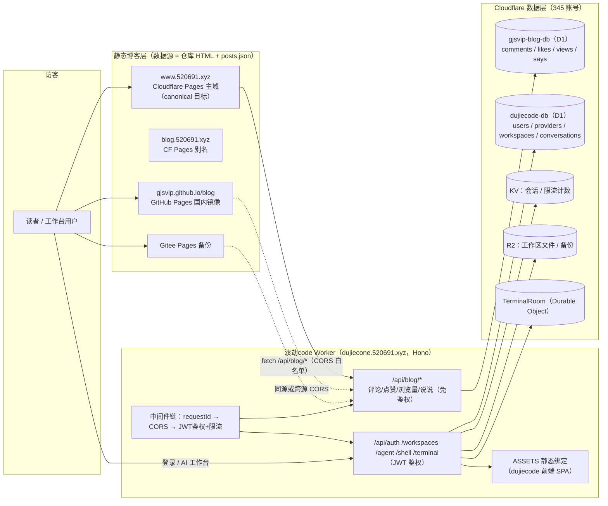
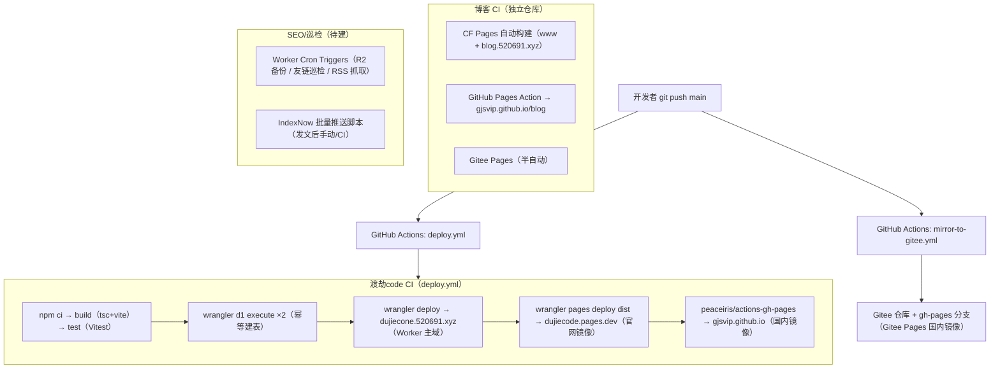
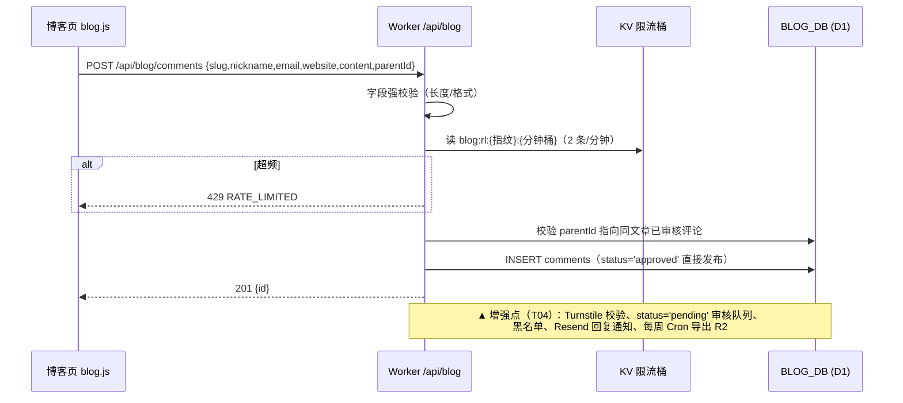
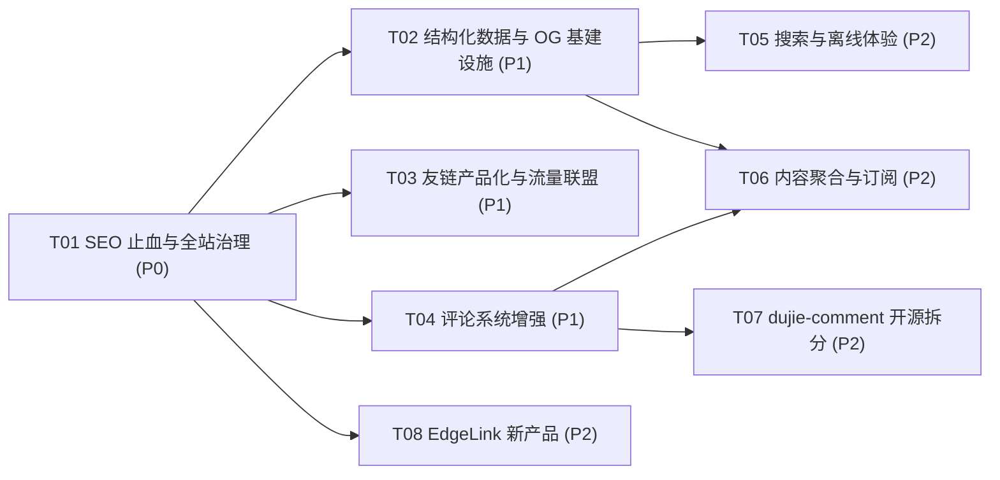

# 渡劫体系架构与扩展路线图（ARCHITECTURE ROADMAP）

> 作者：高见远（Gao）· 架构师 ｜ 日期：2026-10-21 ｜ 版本：v1.0（待 CEO 评审）
> 输入：`docs/PM-BENCHMARK-2026-10-21.md`（许清楚 · 产品经理，友链网络竞品调研）
> 授权依据：CEO「可以新增功能和扩展性和其他项目，根据你的想法来」「吸收百家之长补自己之短」
> 关联仓库：博客静态站（www.520691.xyz）｜渡劫code（dujiecone.520691.xyz，本仓库）

---

## 0. CEO 一分钟版

1. **核心判断**：我们的短板不是技术，是「把能力挂出去的产品化程度」。未来 3 个月主线三件事——
   **① 博客从「能看」做到「能被收录、被订阅、被转发」**（SEO 止血 → 结构化数据 → 友链产品化）；
   **② 评论从「自用」做到「开源可复用」**（补管理后台/反垃圾/备份 → 拆分为 `dujie-comment`）；
   **③ 孵化 1 个开源引流产品**（EdgeLink：边缘短链 + 友链健康巡检，直接服务友链场景）。
2. **部署链路三端不变**（CF Pages 主域 + GitHub Pages 备份 + Gitee 备份），所有改动遵循「可灰度、可回滚」原则；
   凡涉及线上的改动，§6 有逐项灰度与回滚方案。
3. **排期节奏**：本周 P0 止血（改名/软 404/sitemap，共 2.5 人日）→ 第 2~4 周 P1（结构化数据/OG/友链产品化/评论后台，约 11 人日）→ 第 2 个月 P2（全文搜索/PWA/开源拆分/EdgeLink，约 13.5 人日）。
4. **内容 KPI 是架构的前提**：开往联盟要 10 篇原创、多数友链门槛 15 篇——架构所有「引流型」功能都以此为前置条件，篇数不够时不做朋友圈聚合（避免给别人导流，见 §2.4）。
5. **总工作量约 27 人日**（工程师），加上 PM 侧的文章与友链申请，4 周可达「SEO 合格 + 评论可运维 + 开往达标」；第 2 个月可达「评论开源 + 新产品上线」。

---

## 1. 现状架构盘点

### 1.1 三块系统的数据流



**关键现状**：
- 博客互动 API 与业务 Worker **同址同进程**（同一 script `dujiecode`，`/api/blog/*` 挂在 Hono 上，`AUTH_EXEMPTIONS` 白名单放行），共享中间件链、KV、CORS 配置。
- 博客互动数据在**独立 D1 库**（`gjsvip-blog-db`，binding `BLOG_DB`），与业务库（`dujiecode-db`）物理分离——这是后续拆分评论服务的最大有利条件（见 §4-R2）。
- 三端静态站共用同一 API，实现「国内发的评论国际站可见」。

### 1.2 部署链路



### 1.3 评论提交关键序列（现状 → 增强点标注）



### 1.4 已识别问题清单（承接 PM 附录 A，标注归属任务）

| 严重级 | 问题 | 归属任务 |
|---|---|---|
| P0 | 软 404：任意路径返回 200 + text/html（SPA 回退误配，`/assets/avatar.png` 亦 200） | T01 |
| P0 | 站名未替换：「渡劫小站」仍在 title/description/RSS/manifest/友链模板 | T01 |
| P0 | sitemap 串三个域名 + lastmod 全同一天 + RSS 相对路径 | T01 |
| P1 | 无 JSON-LD / 缺 og:image、twitter:card、og:site_name | T02 |
| P1 | 镜像站缺 canonical（重复内容风险） | T01 |
| P2 | 头像/截图直链缺失（友链申请硬需求） | T03 |
| P1 | **IndexNow key 两处记录不一致**（PM 报告 `31cc0198…` vs README `51734a69…`），需核对线上实际 key 文件后统一 | T01 |
| P1 | 评论无管理后台、无反垃圾、无备份导出 | T04 |
| P2 | 静态站手工维护 HTML（head/footer/侧栏每篇重复）不可持续 | §4-R1 / T02 起步 |

---

## 2. 功能扩展路线图

> 排期逻辑：**P0 = 本周止血（搜索引擎视角的「合格站」）；P1 = 第 2~4 周（结构化数据 + 产品化挂出去）；P2 = 第 2 个月起（深度体验 + 开源 + 新产品）**。
> 人日为工程师工作量估算（不含 PM 内容创作）。「影响线上」列对应 §6 灰度/回滚方案。

### 2.1 P0 —— 本周止血（合计 2.5 人日）

| ID | 功能 | 价值 | 改动文件（博客仓库根为基准） | 人日 | 风险 | 影响线上 |
|---|---|---|---|---|---|---|
| F01 | **全站改名**「渡劫小站」→「渡劫博客」 | 品牌一致性；title/OG/RSS/友链模板 name 全量纠正 | `index.html`、`posts/*.html`、`friends.html`、`rss.xml`、`assets/blog.js`（页脚文案）、`robots.txt` 注释 | 0.5 | 漏改角落；友链模板 name 字段同步 | 是（全站替换，CF Pages 预览验证后 promotion） |
| F02 | **修软 404** | 杜绝搜索引擎收录空壳页；`/assets/avatar.png` 类请求回归 404 | 检查并删除 `_redirects` 中的 `/* → /index.html 200` 回退（纯静态站本不需要 SPA fallback）；新增 `404.html`（状态码 404） | 0.5 | 误删导致真 404 页样式丢失；GSC 短期 404 增多属预期 | 是（回滚 = 恢复原 `_redirects` 行） |
| F03 | **sitemap 拆分 + lastmod 真实化 + RSS 绝对地址 + 镜像 canonical** | 收录质量；消除跨域重复内容 | `sitemap.xml` 改为 Sitemap Index（→ `sitemap-blog.xml`）；`rss.xml`（href 绝对化）；`robots.txt`（只指向自己的 sitemap）；镜像仓库 HTML 模板统一注入 `<link rel="canonical" href="https://www.520691.xyz/…">`；`scripts/indexnow.sh` key 核对 | 1.0 | lastmod 需与文章真实 date 对齐（posts.json 为准）；IndexNow key 不一致需先核实 | 是（文件级替换，GSC 观察 1 周） |
| F04 | **页脚信任组件 + 十年之约徽标** | 建站天数/文章数/最后更新/联盟徽标；零门槛流量联盟当天可申请 | `assets/blog.js`（页脚动态计算）、`index.html`（徽标 `<a>`）、`friends.html`（随机逛按钮） | 0.5 | 徽标图需官方深/浅色两版 | 否（新增元素，低风险） |

### 2.2 P1 —— 第 2~4 周（合计约 11 人日）

| ID | 功能 | 价值 | 改动文件 | 人日 | 风险 | 影响线上 |
|---|---|---|---|---|---|---|
| F05 | **JSON-LD 三件套**（WebSite+SearchAction / BlogPosting / BreadcrumbList） | Google 富媒体搜索结果；圈子头部站标配，我们为 0 | 博客 `assets/blog.js`（注入函数）或新增 `assets/structured-data.js`；`index.html`、`posts/*.html`（script 标签）；`posts.json`（确保 date/dateModified/tags 完整） | 1.0 | 模板字段错误会导致 Rich Results 报错；先过 Google Rich Results Test 再上线 | 是（head 注入，渐进式） |
| F06 | **OG 图自动生成**（`/api/og?title=&date=`） | 分享卡片 1200×630；补全 og:image/twitter:card/og:site_name | Worker 侧：`worker/routes/og.ts`（新）、`worker/index.ts`（挂载 + AUTH_EXEMPTIONS）、`wrangler.toml`（无需新绑定）；R2 存中文字体子集；博客侧 `assets/blog.js`（meta 注入指向 /api/og）；退化方案：`scripts/gen-og.mjs` 本地生成静态图 | 1.5 | Workers 图片渲染需 WASM（workers-og/@resvg）；中文字体体积；失败时必须有静态兜底图 | 是（新路由不影响旧路径，前端渐进切） |
| F07 | **友链页产品化** | 卡片化 + 一键复制申请模板 + 失联折叠区 + 自己卡片公开展示（友链转化率核心） | 博客 `friends.html`、`assets/style.css`、`assets/blog.js`；新增 `friends.json`（数据源）；头像/截图直链补真 PNG | 2.0 | 卡片数据需人工维护（后续由 T08 巡检数据半自动）；申请模板 YAML 字段与圈子惯例对齐 | 否（单页增强） |
| F08 | **文章元数据 + 相关阅读内链** | 字数/阅读时长/更新于；底部 3 篇相关文章（SEO 内链 + 停留时长） | 博客 `assets/blog.js`（渲染时计算）、`assets/style.css`；`posts.json`（tags 完整性）；相关推荐算法 = 同标签优先 + 标题词重叠，纯前端零依赖 | 1.0 | 阅读时长 400 字/分假设需校准；相关阅读空标签文章降级为「最新文章」 | 否 |
| F09 | **评论管理后台** | 审核/隐藏/删除/黑名单；`ADMIN_TOKEN` 保护 | Worker `worker/routes/admin.ts`（新：列表/删除/隐藏/审核）、`worker/index.ts`（AUTH_EXEMPTIONS 加 `/api/admin/*`）、`schema-blog.sql`（`banned` 表 + comments.status 支持 pending）；博客侧 `admin/index.html`（纯静态密码页，token 仅存 sessionStorage） | 2.0 | token 前端可见性风险（缓解：sessionStorage + 阅后即焚 + CF Access 评估）；管理操作误删（加软删除 status='hidden'） | 是（Worker 部署，新路由并存灰度） |
| F10 | **邮件回复通知** | 评论被回复时邮件提醒（Workers 不能直连 SMTP → HTTPS API） | Worker `worker/lib/notify.ts`（新，Resend API）、`worker/routes/blog.ts`（POST 后触发，`ctx.waitUntil`）、`wrangler.toml`（`RESEND_API_KEY` secret）；不发明文邮箱（复用 email_md5 + 回填时机） | 1.0 | 邮件投递国内到达率；免费额度 3000 封/月足够 | 是（异步链路，失败不影响评论主流程） |
| F11 | **反垃圾三件套** | Turnstile + 关键词黑名单 + IP 频率限制 | Worker `worker/routes/blog.ts`（Turnstile siteverify）、`assets/blog.js`（widget 渲染）、`schema-blog.sql`（黑名单表） | （并入 F09 计 2.0 内） | Turnstile 国内可过性已由 PM 核实（免费、无 Google 依赖） | 是 |

### 2.3 P2 —— 第 2 个月起（合计约 13.5 人日）

| ID | 功能 | 价值 | 改动文件 | 人日 | 风险 | 影响线上 |
|---|---|---|---|---|---|---|
| F12 | **Ctrl+K 全文搜索增强** | 标题→全文；bigram 中文切词；≥50 篇切 Pagefind | 新增 `search-index.json`（标题+摘要+标签+正文纯文本，构建脚本生成）、`assets/search.js`；`scripts/build-search.mjs`；50 篇后 `scripts/pagefind.mjs`（`npx pagefind --site dist --force-language zh`，必须放构建最后一步） | 1.5 + 0.5 | 索引体积随篇数线性增长（50 篇 ≈ 400KB，gzip ~120KB 可接受）；Pagefind 漏跑 = 新文章搜不到（CI 硬绑定） | 否（懒加载，失败降级现有索引） |
| F13 | **PWA**（manifest + SW） | 离线可读；圈子头部站标配 | `manifest.webmanifest`、`sw.js`（缓存 index/style/blog.js/posts.json，版本化 cache）、`index.html`（注册 SW） | 1.0 | SW 缓存导致更新不生效（版本号 + `skipWaiting` 策略）；先只缓存壳，文章 HTML 后置 | 是（SW 一旦注册影响全站，先灰度一个子路径或仅 manifest 半天上线） |
| F14 | **标签聚合页 + 归档页** | 内链网络 + 收录入口 | `tags/index.html`、`archive/index.html`（或静态生成）、`assets/blog.js`、`posts.json`（tag 字段规范） | 1.0 | 手工维护 → 由 build 脚本生成（见 §4-R1） | 否 |
| F15 | **「随机一篇」+ 外部随机入口** | 停留深度 + 友链互推（foreverblog 虫洞/开往 go.html） | `assets/blog.js`、`friends.html`、`index.html`（导航入口） | 0.5 | 无 | 否 |
| F16 | **订阅体系** | `/subscribe` 页 + 邮件订阅（Worker + D1 + Cron 新文通知） | 博客 `subscribe/index.html`；Worker `worker/routes/subscribe.ts`（新：订阅/退订/确认）、`schema-blog.sql`（`subscribers` 表）、Cron 发新文通知（复用 F10 notify lib） | 1.5 | 反订阅合规（退订链接）；垃圾邮箱域名过滤 | 是（新 D1 表，加表不改表） |
| F17 | **访问统计看板 + RSS 订阅统计** | views/likes/comments 总览与排行；RSS  img 信标测打开率 | Worker `/api/blog/stats` 扩展（总量+排行）；博客 `stats/index.html`（静态看板页 fetch 渲染）；RSS 信标 `/api/blog/rss-view` | 2.0 | views 双写放大 D1 写入配额（10 万行/天免费上限，当前流量远低，加监控告警）；趋势曲线需日表，本期只做累计值 | 是（新增只读 API + 新页） |
| F18 | **Webmention 接收** | indieweb 圈层认可；评论外互链 | Worker `worker/routes/webmention.ts`（新：source/target 校验）、`schema-blog.sql`（`webmentions` 表）、文章页展示 | 1.0 | 来源验证防滥用（fetch source 页面确认含 target 链接） | 是（新路由） |
| F19 | **`dujie-comment` 开源化** | 友链敲门砖 + 内容资产 + 引流 | 见 §3.1 与 T07 | 3.5 | 拆分涉及 API base 切换（灰度方案见 T07） | 是 |

### 2.4 明确不做 / 暂缓（架构师的取舍）

| 候选 | 决策 | 理由 |
|---|---|---|
| Algolia 接入 | **不做** | 依赖第三方 SaaS、国内访问一般、违背 CF 全栈定位；本地索引 → Pagefind 路线已定（PM §3.1 结论一致） |
| 打赏/赞赏 | **暂缓** | 无流量基数收益极低；页脚预留入口即可 |
| 友链朋友圈（RSS 聚合） | **暂缓至友链 ≥15 且文章 ≥10 篇** | 现在做是给别人的站导流；届时用 T08 的巡检 Cron 顺手抓 feeds，成本最低 |
| 相册/备忘录子域 | **暂缓**（备选产品池） | 引流利器但成本高（R2 图床 + 前端），排 P2 之后；先做 EdgeLink |
| Twikoo/Waline 迁移 | **不做** | 自建 D1 方案 + 《CF D1 自建评论》文章已是差异化资产；正确动作是补短板（F09~F11）不是推翻 |
| APlayer 音乐 | **不做** | 与「技术博客」定位不符，拖慢加载 |

---

## 3. 新产品方向（CEO 授权范畴）

> 原则：**都能跑在现有 345 CF 账号免费额度内、都能反哺博客内容与友链网络、都零 VPS**。

### 3.1 产品一：`dujie-comment` —— 可一键部署的静态站评论系统（开源）

- **一句话定位**：Cloudflare Workers + D1 的零成本评论托管服务，`fork → wrangler deploy` 两条命令上线，「为什么不用 Twikoo」写在 README 第一行。
- **目标用户**：Hexo/Astro/纯静态博客站长（圈子 >50% 用 Twikoo，但官方 CF 版有兼容性坑；Giscus 要求 GitHub 账号国内转化率低）——这是我们验证过的真实缺口。
- **MVP 文件清单**（新仓库 `dujie-comment/`）：
  ```
  dujie-comment/
  ├── worker/
  │   ├── index.ts            # Hono 入口（comments/likes/views/says/admin）
  │   ├── routes/comments.ts  # 自 worker/routes/blog.ts 迁移（已含指纹/限流/树形）
  │   ├── routes/admin.ts     # ADMIN_TOKEN 管理 API（F09 产物直接复用）
  │   ├── routes/backup.ts    # Cron → R2 周备份
  │   ├── lib/security.ts     # visitorHash / md5 / 限流（自 worker/lib/core.ts 抽离）
  │   └── lib/notify.ts       # Resend 通知（F10 产物）
  ├── schema.sql              # D1 建表（自 schema-blog.sql 泛化，去 siteshot 强耦合）
  ├── wrangler.toml           # D1/KV/R2 绑定 + cron triggers + CORS_ORIGINS
  ├── client/
  │   ├── dujie-comment.js    # vanilla JS 嵌入组件（<script src> 即用，零构建）
  │   └── dujie-comment.css   # 暗/亮双主题 CSS 变量
  ├── docs/deploy.md          # Fork → 建 D1/KV/R2 → wrangler deploy → 嵌两行代码
  ├── docs/api.md             # REST 契约（GET/POST/DELETE 评论契约即现网契约）
  ├── .github/workflows/deploy.yml
  ├── tests/                  # Vitest 纯函数单测（自 tests/ 迁移）
  ├── README.md               # 为什么不用 Twikoo/Waline/Giscus + 对比表 + 在线演示
  └── LICENSE (MIT)
  ```
- **与现有架构的复用关系**：评论后端代码 **80% 直接迁移**（blog.ts 已在生产验证）；F09/F10 的管理与通知即为其核心差异化；部署后用独立子域（如 `comment.520691.xyz`）承接现网博客，原 `/api/blog/*` 并行双跑（见 T07 灰度）。
- **上线路径**：T04 完成（管理+反垃圾+备份就绪）→ T07 抽离开源 → 博客文章选题 1《CF D1 + Worker 自建评论系统》同步发布 → 作为友链申请材料（「我给你带了一个可一键部署的评论系统」）。

### 3.2 产品二：EdgeLink（渡劫链）—— 边缘短链 + 站点健康巡检

- **一句话定位**：跑在 Cloudflare 边缘的短链跳转 + 友链/站点健康巡检 API，给独立博客圈提供「失联检测」公共服务（PM 实测：轻笑 192 张友链卡 23 张 ERR、51 张 >10s，亚健康率 38.5%；一级 10 站 1 站已死）。
- **目标用户**：需要友链巡检的博客站长（June 每 3 小时抓一次 RSS 的「产品化平替」）+ 需要短链的开发者。
- **MVP 文件清单**（新仓库 `edgelink/`）：
  ```
  edgelink/
  ├── worker/
  │   ├── index.ts          # 路由：/{code} 跳转 / api/links CRUD / api/check
  │   ├── routes/links.ts   # 短链 CRUD + 点击计数（KV 读热 + D1 落库）
  │   ├── routes/check.ts   # 巡检：fetch HEAD 记 latency/失败次数，公开只读 API
  │   ├── lib/shortcode.ts  # 6 位随机码（去易混淆字符）+ 防撞
  │   ├── cron.ts           # scheduled：每 6h 巡检（crons = ["0 */6 * * *"]）
  │   └── lib/core.ts       # 复用渡劫code 的 httpError/newId/CORS 中间件模式
  ├── schema.sql            # links(url,code,clicks,created_at) / checks(url,ok,latency_ms,checked_at)
  ├── wrangler.toml         # KV + D1 + cron triggers + 自定义域 link.520691.xyz
  ├── admin/index.html      # 极简管理页（token 模式同 F09）
  └── README.md             # 公开 API 文档 + 「博客友链检测」按钮嵌入代码
  ```
- **与现有架构的复用关系**：中间件/CORS/错误归一化模式照搬 `worker/index.ts`；KV+D1+Cron 全在免费额度；域名体系新增一个子域（DNS CNAME 到 workers.dev，proxied=true，同 dujiecone 模式）。
- **上线路径**：本地 `wrangler dev` → 部署 `link.520691.xyz` → 博客 `/friends` 页加「一键检测友链」按钮（调用公开只读 API）→ 文章选题 7《用 Cloudflare Cron 做友链健康巡检》发布（产品即内容）→ 免费巡检 API 作为友链敲门砖。**对现有系统零影响**（全新子域 + 新仓库）。

### 3.3 备选产品池（暂缓，CEO 可随时点将）

| 产品 | 一句话定位 | 启动条件 |
|---|---|---|
| dujie-weekly 技术周刊 | 双周刊邮件 = 博客精选 + 友链圈动态，Worker + D1 + Resend | 订阅用户 ≥200（F16 之后） |
| AI 摘要生成器 | 粘贴 URL → Workers AI 生成摘要 + OG 卡（博客内部功能优先） | 博客自身先用起来再说 |
| status 状态页 | 渡劫code/博客/API 的 uptime 展示页 | EdgeLink 巡检数据积累后顺手做 |

---

## 4. 架构风险与债务

### R1 静态站手工维护 HTML 不可持续（高优先）

- **现状**：每篇文章一个手写 HTML，head/meta/footer/侧栏/TOC 重复维护；改名（F01）要全量替换就是症状。
- **演进路径（保持部署链路不变）**：
  1. **第一阶段（T02 起步，本周即可）**：新增 `build/build.mjs`（Node 零依赖脚本）。以 `posts.json` 为唯一数据源，模板化生成 head（meta/OG/JSON-LD/canonical）、页脚、TOC；产物仍是纯静态 HTML，**URL 结构不变**（`/posts/xxx.html`），CI 产物推 CF Pages + gh-pages，部署链路零改动。
  2. **第二阶段（篇数 >30 或频繁改版时）**：迁移 **Astro**（内容集合 + 组件，输出纯静态）或 Vite MPA；同样只换构建器、不换部署器。旧 URL 用 `_redirects` 301 映射表承接。
  3. **永远不做**：动态 SSR（会失去 GitHub/Gitee 镜像可达性与零成本）。
- **灰度**：生成器先在 `preview.520691.xyz`（Pages 预览域）与手写页逐页 diff，全等后切生产。

### R2 评论 API 与业务 Worker 同址耦合（中优先，拆分时机已明确）

- **现状**：`/api/blog/*` 与业务 API 同一 script，共享发布节奏、KV 命名空间、CORS 白名单；评论面向公网三端 + 未来开源用户，攻击面与业务 API 不同。
- **拆分时机**：**`dujie-comment` 决定开源时（T07）必须拆**；或出现以下任一信号提前拆：评论滥用影响业务 API 限流 / 两者需要独立发布节奏 / Worker CPU 因评论查询超限。
- **拆分方案（零数据迁移）**：D1 支持同一 `database_id` 绑定多个 Worker——新 Worker `dujie-comment` 直接绑定现有 `gjsvip-blog-db`，**无需导出导入**；共享代码抽为 `lib/`（见 §3.1）。博客前端 `blog.js` 的 API base 改为配置项（`localStorage` 可覆盖），双跑 2 周后切换，回切只需改一个配置。

### R3 D1 数据量增长后的分页与归档（低优先，先立规矩）

- **现状容量**：D1 免费额度 5GB 存储 + 500 万行读/天 + 10 万行写/天；个人博客评论/点赞/浏览用到此上限需数年，但**写入放大**要先防：`views` UPSERT 每次浏览 1 行写 → 10 万浏览/天即触顶。
- **策略**：① `GET /api/blog/comments` 加 `LIMIT + cursor`（`created_at` 游标），前端「加载更多」；② 浏览量改 **KV 缓冲 + Cron 批量 flush 到 D1**（写放大 ÷60）；③ 月度 Cron 导出 `comments/likes/views` 全量 JSON 到 R2（`dujie-comments/YYYY-MM.json`）兼做归档与备份；④ 冷数据（>1 年）可选择性从 D1 清理，R2 存档可查。
- **监控点**：D1 控制台每日读写行数 + Worker 日请求数，超 50% 额度告警（进 §5 看板）。

### R4 多域名 cookie 与 CORS 治理（立即执行）

- **Cookie**：`dj_session` 为 HttpOnly **host-only** cookie（未设 Domain），`dujiecone` 与 `www`/`blog` 不互通——当前安全姿态正确，**保持不设 `Domain=.520691.xyz`**（避免 CSRF 面扩大到全子域）；未来若做统一登录，走 OAuth 式跳转而非共享 cookie。
- **CORS**：白名单集中在 `wrangler.toml` 的 `CORS_ORIGINS`（已覆盖主域/博客/镜像/GH/Gitee）。**新增域名 checklist**：① wrangler.toml 加源 → ② `wrangler deploy` → ③ 三端回归评论/点赞 → ④ 更新本文档 §1.3。新 Worker（EdgeLink）独立配置自己的白名单，不复用业务 Worker 的。
- **robots 治理**：`dujiecone.520691.xyz/robots.txt` 已有 `Disallow: /api/`；EdgeLink 的 `/api/check` 是**故意公开**的（产品需要），单独放行并在文档注明。

### R5 密钥与凭据管理（中优先）

- **现状**：`.deploy-secrets.txt` 本地明文存 `ENCRYPTION_KEY/JWT_SECRET`——丢失 = 全部用户 API Key 不可解密。
- **动作**：① 迁移进密码管理器（Bitwarden/1Password）并加密归档；② 文件加入 `.gitignore` 确认（已确认）；③ 制定 `JWT_SECRET` 轮换预案（轮换即全量登出，可接受）；④ CI secrets 清单在 README 维护（已有雏形）。

### R6 配置双源不一致（低优先，本周顺手）

- IndexNow key 在 PM 报告与 README 中记录不一致（T01 核对统一）；旧 CF 账号（`dujie_nb`）资源虽已弃用，`wrangler.toml` 注释保留历史信息——建议每季度清理一次注释型知识，统一沉淀到本文档。

---

## 5. 下一步任务分解（可直接交付工程师）

> 排序即执行顺序；每个任务独立可验收；「影响线上」任务必须按 §6 执行灰度与回滚。
> 博客侧路径以**博客仓库根**为基准；Worker 侧路径以**dujiecode 仓库根**为基准。

### T01 · SEO 止血与全站治理（P0，2.5 人日，无依赖）

- **目标**：搜索引擎视角的「合格站」；品牌统一；镜像 canonical。
- **创建/修改文件**：
  - 博客：`index.html`、`posts/*.html`、`friends.html`、`rss.xml`、`robots.txt`、`sitemap.xml`（改 Index）、`sitemap-blog.xml`（新）、`404.html`（新）、`_redirects`（删 SPA 回退行）、`assets/blog.js`、`assets/style.css`（页脚组件）、`scripts/indexnow.sh`（key 核对）
  - 镜像：GitHub Pages 模板注入 canonical 标签
- **验收**：GSC 抓取测试无 200 空壳页；Rich Results Test 暂无错误（T02 后）；`/assets/avatar.png` 返回 404；sitemap 仅含 www URL 且 lastmod 为真实日期；IndexNow 202。
- **上线影响**：全站替换 + 搜索引擎重抓。灰度：CF Pages 预览部署 diff → promotion；回滚：Pages 一键回滚上一部署 / git revert。

### T02 · 结构化数据与 OG 基础设施（P1，2.5 人日，依赖 T01）

- **目标**：JSON-LD 三件套 + `/api/og` + head 模板化（R1 第一阶段起步）。
- **创建/修改文件**：
  - Worker：`worker/routes/og.ts`（新）、`worker/index.ts`（挂载 + 豁免）、R2 上传中文字体子集
  - 博客：`build/build.mjs`（新，模板化 head/meta/footer，`posts.json` 驱动）、`assets/blog.js`（注入 JSON-LD + og:image 指向 /api/og）、`posts.json`（补 dateModified/tags）
- **验收**：Rich Results Test 通过 WebSite/BlogPosting/BreadcrumbList；分享到社交平台有 1200×630 卡片；构建产物与手写页 diff 为空（灰度期）。
- **上线影响**：head 变更。灰度：preview 域验证 → promotion；回滚：revert。`/api/og` 为新路由，旧路径无损。

### T03 · 友链页产品化与流量联盟接入（P1，2.5 人日，依赖 T01）

- **目标**：卡片化 + 申请模板复制 + 失联折叠区 + 十年之约徽标 + 随机一篇（F04/F07/F15）。
- **创建/修改文件**：博客 `friends.json`（新）、`friends.html`、`assets/style.css`、`assets/blog.js`；头像 PNG 与 1200×630 siteshot 补齐。
- **验收**：`/friends` ≥8 张卡（含自己卡片）；「申请互链」按钮一键复制 YAML；十年之约徽标上线。
- **上线影响**：单页增强，低风险。

### T04 · 评论系统增强（P1，4.0 人日，依赖 T01）

- **目标**：管理 API + Turnstile + 审核队列 + R2 周备份 + Resend 通知（F09/F10/F11）。
- **创建/修改文件**：
  - Worker：`worker/routes/admin.ts`（新）、`worker/lib/notify.ts`（新）、`worker/routes/blog.ts`（Turnstile + pending + 备份导出）、`worker/index.ts`（AUTH_EXEMPTIONS 加 `/api/admin/*` + scheduled handler）、`schema-blog.sql`（`banned` 表，comments.status 语义扩展）、`wrangler.toml`（crons + CORS_ORIGINS 复核）
  - 博客：`admin/index.html`（新，静态密码页）、`assets/blog.js`（Turnstile widget + pending 提示）
- **验收**：后台可列表/隐藏/删除/审核/拉黑；R2 出现 `dujie-comments/2026-XX-XX.json`；测试回复触发邮件；超频与黑名单生效。
- **上线影响**：**Worker 部署影响所有三端评论**。灰度：新路由并存上线（默认行为不变）→ 前端开关切换 Turnstile/pending → 观察 48h；回滚：git revert + CI 重部署（≤5 分钟）。

### T05 · 搜索与离线体验（P2，2.5 人日，依赖 T02）

- **目标**：`search-index.json` 全文索引 + Ctrl+K 升级 + manifest + SW（F12/F13）。
- **创建/修改文件**：博客 `scripts/build-search.mjs`（新，并入 build.mjs 流水线）、`search-index.json`（构建产物）、`assets/search.js`、`manifest.webmanifest`（新）、`sw.js`（新）、`index.html`。
- **验收**：Ctrl+K 可搜正文关键词；Lighthouse PWA ≥80；离线可读首页与已访文章。
- **上线影响**：SW 影响全站缓存。灰度：先只上 manifest（0.5 天）→ SW 仅缓存静态壳 → 版本化 cache + 发布说明；回滚：反注册 SW（`sw.js` 置空 + `unregister`）。

### T06 · 内容聚合与订阅（P2，4.5 人日，依赖 T02 + T04）

- **目标**：标签页/归档页/相关阅读 + `/subscribe` + 邮件订阅 + 统计看板（F08 已完成部分并入 + F14/F16/F17）。
- **创建/修改文件**：
  - 博客：`tags/index.html`、`archive/index.html`、`subscribe/index.html`、`stats/index.html`（新，或由 build.mjs 生成）、`assets/blog.js`、`assets/style.css`
  - Worker：`worker/routes/subscribe.ts`（新）、`worker/routes/blog.ts`（stats 扩展 + rss-view 信标）、`schema-blog.sql`（`subscribers` 表）
- **验收**：标签/归档页被 sitemap 收录；订阅确认邮件可达；看板展示总量与 Top10 文章。
- **上线影响**：新表新路由新页面，低-中风险。

### T07 · `dujie-comment` 开源化与拆分（P2，3.5 人日，依赖 T04）

- **目标**：独立 Worker + 开源仓库 + 文档 + 现网双跑切换（F19 / §3.1）。
- **创建/修改文件**：新仓库 `dujie-comment/`（§3.1 清单）；博客 `assets/blog.js`（API base 配置化）；渡劫code 仓库 `worker/routes/blog.ts` 保留至切换完成。
- **验收**：fork 用户 10 分钟完成部署（文档实测）；现网评论经新域读写正常 2 周；旧路径并行无差异。
- **上线影响**：**API base 切换是三端评论的关键变更**。灰度：双跑 2 周（新旧域同库）→ 前端配置开关切流（可按 10%→50%→100%）→ 旧路由保留 30 天后下线；回滚：配置切回旧 base（秒级）。

### T08 · EdgeLink 新产品（P2，3.0 人日，依赖 T01 的域名治理规范）

- **目标**：短链 + 巡检上线 `link.520691.xyz`，博客集成检测按钮，文章选题 7 发布（§3.2）。
- **创建/修改文件**：新仓库 `edgelink/`（§3.2 清单）；博客 `friends.html`（检测按钮）；DNS：`link CNAME dujiecode.dujie.workers.dev`（proxied）。
- **验收**：短链跳转 <50ms；巡检 API 返回友链 latency；Cron 每 6h 落库。
- **上线影响**：**零影响现有系统**（新子域 + 新仓库 + 新 D1/KV）；域名按 R4 checklist 登记。

### 任务依赖图



### 排期总表（与 PM 的 4 周内容计划并行）

| 周次 | 工程任务 | PM/内容侧 | 里程碑判定 |
|---|---|---|---|
| W1 | T01 完成；T03 数据准备 | 发文 1~2 篇；申请十年之约 | SEO 三项 P0 上线；GSC 无软 404 |
| W2 | T02 完成；T03 完成；T04 启动 | 发文 3~4 篇；第一批友链申请 6~8 家 | Rich Results 通过；/friends ≥8 卡 |
| W3 | T04 完成；T08 启动 | 发文 5~6 篇 | 评论后台可用；R2 备份就绪 |
| W4 | T08 完成；T05 启动 | **文章达 10 篇原创 → 提交开往**；第二批友链 | 开往通过；EdgeLink 上线 |
| M2 | T05/T06/T07 | 友链 ≥15 → 评估朋友圈 | dujie-comment 开源；PWA 上线 |

---

## 6. 上线影响与灰度/回滚总表

| 变更 | 影响面 | 灰度方式 | 回滚方式 | 预计耗时 |
|---|---|---|---|---|
| F01/F03 全站替换 + sitemap | 全站 HTML、搜索引擎 | CF Pages 预览部署 diff → promotion | Pages 控制台一键回滚上一部署 | 分钟级 |
| F02 软 404 修复 | CF Pages 路由行为 | 先仅在 www 主域生效，镜像站观察 1 周 | 恢复 `_redirects` 回退行 | 分钟级 |
| F05/F06 JSON-LD + OG | head 内容、Worker 新路由 | Rich Results Test / 分享预览先行；/api/og 失败有静态兜底图 | git revert + CI 重部署 | ≤5 分钟 |
| F09~F11 评论增强 | **Worker 全量（三端评论）** | 新路由并存；默认行为不变；前端开关切 Turnstile/pending，48h 观察 | git revert + CI 重部署 | ≤5 分钟 |
| F13 PWA SW | 全站缓存 | 先 manifest（0.5 天）→ SW 仅缓存静态壳；版本化 cache | 置空 sw.js + 反注册 | 分钟级 |
| T07 评论 API 拆分 | 三端评论读写 | 新旧域同库双跑 2 周；前端开关 10%→50%→100% 切流；旧路由保留 30 天 | 配置切回旧 base（秒级） | 秒级 |
| T08 EdgeLink | 无（新子域新库） | — | 删 DNS 记录即下线 | 分钟级 |
| D1 schema 变更 | 数据层 | 只加表/加列（IF NOT EXISTS），先 R2 备份再执行 | 备份恢复 | 小时级 |

**通用纪律**：① 所有 D1 变更前先执行一次导出到 R2；② Worker 部署窗口避开 PM 友链申请高峰期（工作日白天）；③ 每次影响线上的部署后在本文档记录版本号与日期。

---

## 7. 待确认问题（Anything UNCLEAR）

1. **博客仓库是否与渡劫code 同仓库**：本文件中博客侧路径假设为独立仓库（根目录即站根）。若实际在同仓库子目录，T01~T06 文件路径需平移，工作量估算不变。
2. **`/api/og` 中文字体来源**：计划 R2 存 Noto Sans SC 子集（约 300~600KB）。若 CEO希望零 R2 占用，退化为构建期静态生成每篇一张（`scripts/gen-og.mjs` + sharp），工作量 +0.5 人日。
3. **EdgeLink 域名**：建议 `link.520691.xyz`；若希望与渡劫体系命名统一（如 `dujie.link`），需新增 DNS，CI 无感。
4. **CF Access 评估**：评论后台若未来觉得 token 模式不安全，可评估 Cloudflare Access（Zero Trust）保护 `/api/admin/*`——需确认国内访问 cloudflareaccess.com 的可达性后再定。
5. **IndexNow key 统一值**：需工程师登录服务器核对线上 `*.txt` key 文件实际内容，以线上为准回填两处文档。
6. **打赏/相册是否提前**：CEO 若认为人格化展示（相册/装备页）对友链转化更重要，可将「装备页」从备选池提升至 P2（+1 人日，纯静态页）。

---

*本文档为活文档：每次影响线上的部署后更新「通用纪律」记录；每月随 PM 的友链申请进展复审 P2 优先级。*
