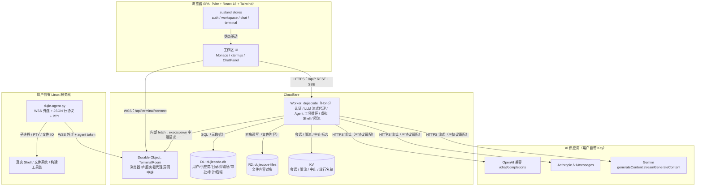
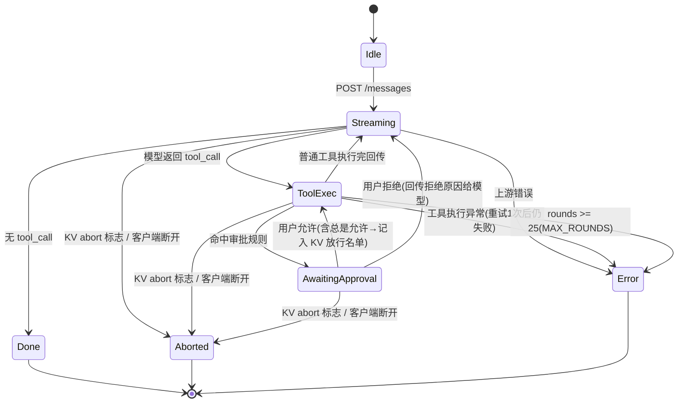
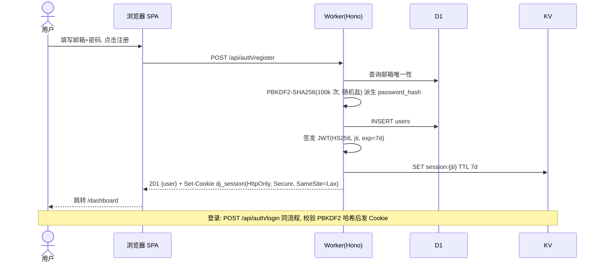
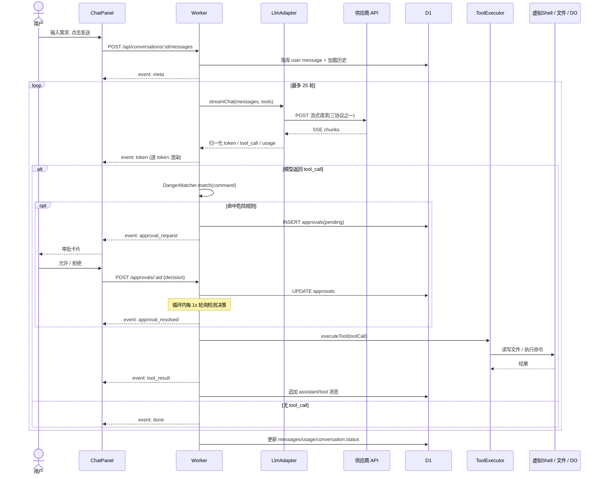
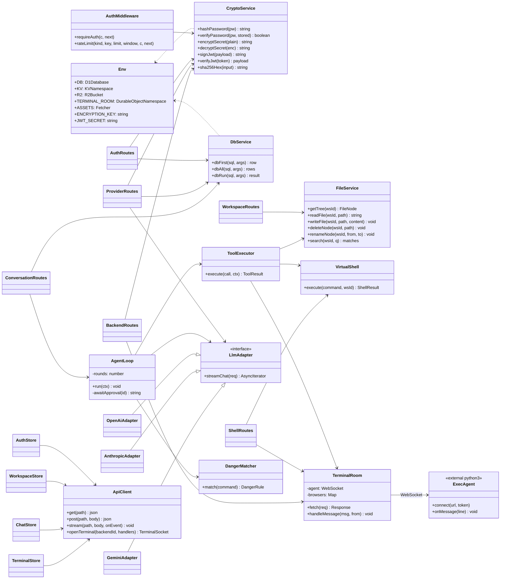

# 渡劫code（DujieCode）系统架构设计文档

| 项 | 内容 |
|---|---|
| 文档版本 | v1.0 |
| 作者 | 高见远（Gao）· 软件开发团队 架构师 |
| 上游输入 | `docs/PRD.md` v1.0（许清楚） |
| 技术形态 | Vite + React 18 + TypeScript + Tailwind CSS + Monaco + xterm.js + zustand |
| 后端 | Cloudflare Worker（Hono）+ D1 + R2 + KV + 1 个 Durable Object |
| 源码规模 | 45 个文件（不含 node_modules / dist / docs） |
| 部署 | Worker `dujiecode`（dujiecode.dujie-nb.workers.dev）+ Pages `dujiecode`（dujiecode.pages.dev） |

---

## 0. 对 PRD 的架构级变更（CEO 已拍板，覆盖 PRD 默认值）

| PRD 原设计 | 本架构决策 | 理由 |
|---|---|---|
| F01 邮箱魔法链接 + GitHub OAuth | **邮箱 + 密码**（PBKDF2-SHA256 ≥10 万次迭代 + 每用户随机盐，D1 存储）；JWT 存 HttpOnly Cookie，会话记录存 KV | 无外部邮件服务可用，必须完全自包含可部署；GitHub OAuth 与魔法链接列 P1 |
| 零知识客户端加密（客户端派生密钥） | **服务端信封加密**：Workers Secret `ENCRYPTION_KEY`（32 字节 hex）作主密钥，AES-256-GCM 加密 API Key / agent token 后存 D1；UI 明示"静态加密" | 服务端可用的密钥才能被 Agent 循环与终端代理调用；零知识客户端加密列 P1 |
| F06 WebSocket→TCP SSH 代理 | **执行代理方案**：用户自有 Linux 服务器运行一键安装的 Python3 单文件代理，通过 WSS 外连 DO `TerminalRoom`，收发 JSON 行协议（exec/spawn/data/exit）；浏览器 xterm.js ⇄ DO ⇄ 服务器代理 | Worker 内实现 SSH 客户端工作量不可行；agent 主动外连无需暴露服务器端口、无需在 Worker 持有私钥 |
| MUI 组件库 | **Tailwind CSS**（IDE 级深色 UI，自绘组件） | 与 CEO 技术栈决策一致，体积更小、定制更深 |
| 凭据 = SSH 私钥/密码加密存储 | 凭据 = **每后端一个 agent token**（SHA-256 哈希存储，创建时仅展示一次） | agent 外连模型下 Worker 永远不需要 SSH 私钥；token 可轮换、可吊销 |

---

## 1. 总体架构

### 1.1 架构图（组件关系与数据流）



### 1.2 数据流说明

| 链路 | 协议 | 说明 |
|---|---|---|
| 浏览器 ⇄ Worker | HTTPS（`/api/*`，JSON + SSE） | 所有 REST 与 LLM 流式对话；静态资源由 Worker 经 `ASSETS` 绑定从 `dist/` 提供，SPA 回退 `index.html` |
| 浏览器 ⇄ DO `TerminalRoom` | WSS（`/api/terminal/connect?backendId=`） | 终端 Tab：xterm.js 输入输出、spawn/resize/kill |
| Worker ⇄ DO | 内部 `fetch`（`stub.fetch`） | AI `run_command` 路由到远程后端时，由 Worker 向 DO 发起 exec 请求并等待 exit 汇总返回 |
| 服务器代理 ⇄ DO | WSS（`/api/agent/connect?backendId=&token=`） | Python 代理主动外连，JSON 行协议收发 |
| Worker ⇄ 供应商 | HTTPS 流式 | 三协议适配器归一化为内部事件流 |
| Worker ⇄ D1/R2/KV | 绑定直连 | 元数据 / 文件内容 / 会话与限流 |

---

## 2. 技术选型表

| 层 | 选型 | 版本 | 理由 |
|---|---|---|---|
| 前端框架 | React 18 + TypeScript | ^18.3 / ^5.5 | 生态成熟；Monaco/xterm 均有官方 React 封装；严格类型降低联调成本 |
| 构建 | Vite 5 | ^5.4 | 开发服务器快、产物体积小；`publicDir` 可直接把代理脚本复制进 dist |
| 样式 | Tailwind CSS v4（`@tailwindcss/vite` 插件） | ^4.0 | 无需 postcss/tailwind.config 单独配置文件（省 2 个文件）；CSS 变量 `@theme` 定义深色 IDE 主题 |
| 路由 | react-router-dom | ^6.26 | SPA 路由标准方案 |
| 状态 | zustand | ^4.5 | 轻量、无 boilerplate；4 个 store 覆盖认证/工作区/对话/终端 |
| 编辑器 | @monaco-editor/react | ^4.6 | VS Code 内核，多标签/语法高亮/大文件；路由级懒加载，不影响官网首屏 |
| 终端 | @xterm/xterm + addon-fit | ^5.5 / ^0.10 | 浏览器终端事实标准 |
| 后端框架 | Hono | ^4.6 | Workers 一等公民、体积极小、中间件模型清晰、 ultrafast 路由 |
| 数据库 | D1（SQLite） | — | 目录树/消息/审批等关系型元数据；绑定直连、零运维 |
| 对象存储 | R2 | — | 文件内容；S3 兼容、无出口费用 |
| KV | Workers KV | — | 会话、限流计数、中止标志、放行名单；最终一致可接受（均非强一致场景） |
| 实时通道 | Durable Object（`TerminalRoom`，单类） | — | 每个后端一个房间，天然单点串行、可持有 WebSocket 对等体；支持休眠降低计费 |
| 密码哈希 | PBKDF2-SHA256（WebCrypto，100,000 次迭代，16 字节随机盐） | — | Workers 运行时原生 `crypto.subtle`，无外部依赖；满足 PRD 迭代次数要求 |
| 密钥加密 | AES-256-GCM（信封加密简化实现：主密钥 + 每记录 12 字节随机 IV） | — | `crypto.subtle` 原生支持；认证加密防篡改 |
| 会话 | JWT HS256（自签，HMAC-SHA256）+ HttpOnly Cookie + KV 会话记录 | — | 无状态校验 + 可服务端吊销（删 KV 记录即登出） |
| LLM 流式 | 自研三协议适配器（OpenAI / Anthropic / Gemini），归一化为 SSE | — | 模型中立是产品核心；统一事件流简化前端与 Agent 循环 |
| 测试 | Vitest（node 环境，测纯函数：crypto 往返 / shell 解析） | ^2.0 | 原生支持 TS；不引入 miniflare 控制依赖规模 |
| 部署 | wrangler（Workers + Pages 同一仓库） | ^3.78 | `npm ci && npm run build && wrangler deploy` 一键上线 |

---

## 3. 目录与文件清单（45 个文件，工程师严格按此实现）

### 3.1 根目录（8）

| # | 相对路径 | 职责 | 关键导出 |
|---|---|---|---|
| 1 | `package.json` | 依赖声明与脚本（dev/build/deploy/pages/db:init/test） | scripts、dependencies、devDependencies |
| 2 | `tsconfig.json` | TS 严格模式；`paths: {"@shared/*": ["shared/*"]}`；types 含 `@cloudflare/workers-types`、`vite/client` | — |
| 3 | `vite.config.ts` | Vite 配置：react + tailwindcss 插件、`@shared` alias、`publicDir: "agent"`（把代理脚本复制进 dist）、outDir `dist` | default config |
| 4 | `wrangler.toml` | Worker 部署：name/main/assets/D1/KV/R2/DO/vars/migrations（完整内容见 §9） | — |
| 5 | `index.html` | SPA 入口 HTML（`<div id="root">`、`main.tsx`、lang="zh-CN"） | — |
| 6 | `schema.sql` | D1 初始化建表脚本（完整内容见 §4.1） | — |
| 7 | `README.md` | 项目说明、本地开发、部署、一键安装命令、CLOUDFLARE_API_TOKEN 用法 | — |
| 8 | `.gitignore` | node_modules / dist / .dev.vars / .wrangler | — |

### 3.2 shared（2）——前后端类型与常量共享

| # | 相对路径 | 职责 | 关键导出 |
|---|---|---|---|
| 9 | `shared/types.ts` | 前后端共享类型：User、ProviderView、Workspace、FileNode、Conversation、Message、Approval、AuditLog、ExecBackend、AgentTokenView、SSEEvent 联合类型、ToolCall、ToolDefinition、AgentWsMessage（终端协议）、ApiError | 全部 interface / type |
| 10 | `shared/constants.ts` | 常量：SSE_EVENTS、MAX_AGENT_ROUNDS=25、SHELL_WHITELIST、DANGER_RULES（危险规则表）、RATE_LIMITS、TOKEN_TTL_DAYS=7、READ_FILE_MAX_CHARS=100000、TOOL_OUTPUT_MAX_CHARS=50000、ID_PREFIX | 常量对象 |

### 3.3 前端 src（18）

| # | 相对路径 | 职责 | 关键导出 |
|---|---|---|---|
| 11 | `src/main.tsx` | React 挂载 + BrowserRouter + 全局 CSS 引入 | default |
| 12 | `src/App.tsx` | 路由表（§6.1）+ 懒加载 + RequireAuth 守卫 + 404 回退 | default App |
| 13 | `src/index.css` | Tailwind v4 `@import` + `@theme` 深色 IDE 主题变量（§6.4）+ xterm/monaco 微调样式 | — |
| 14 | `src/api.ts` | fetch 封装（JSON、错误归一化 ApiError）、SSE 流式读取器、TerminalSocket（WSS 封装，onData/onExit/onError） | api、TerminalSocket |
| 15 | `src/store/auth.ts` | 认证状态：user、bootstrap()、login/register/logout | useAuthStore |
| 16 | `src/store/workspace.ts` | 工作区列表/当前工作区/文件树/编辑器 Tab/增删改查/搜索/toast/审批铃铛计数 | useWorkspaceStore |
| 17 | `src/store/chat.ts` | 会话列表/消息/流式状态（streamingText、currentToolCall）、send/abort/regenerate、审批决定 | useChatStore |
| 18 | `src/store/terminal.ts` | 终端会话 Tab（虚拟 Shell / 各远程后端）、TerminalSocket 生命周期、write/resize/kill | useTerminalStore |
| 19 | `src/pages/LandingPage.tsx` | 官网落地页：Hero、特性、双终端示意、架构简图、快速开始（含一键安装命令）、FAQ、页脚 | default LandingPage |
| 20 | `src/pages/LoginPage.tsx` | 邮箱+密码注册/登录表单（切换 Tab）、错误提示、安全说明 | default LoginPage |
| 21 | `src/pages/DashboardPage.tsx` | 工作台：工作区卡片、新建工作区对话框、最近会话列表 | default DashboardPage |
| 22 | `src/pages/WorkspacePage.tsx` | 工作区页骨架：顶栏 + 三区布局 + 底部终端面板 + 审批弹窗挂载 | default WorkspacePage |
| 23 | `src/pages/SettingsPage.tsx` | 设置页（Tab：供应商 / 执行后端 / 通用），内嵌 ProviderForm、BackendForm、审计日志列表 | default SettingsPage |
| 24 | `src/components/Layout.tsx` | 应用外壳：顶栏（Logo、后端切换、审批铃铛、设置、用户菜单）、Outlet | default Layout |
| 25 | `src/components/FileTree.tsx` | 文件树：懒展开、新建/重命名/删除菜单、点击打开 Tab | default FileTree |
| 26 | `src/components/EditorPane.tsx` | Monaco 多标签编辑区：Tab 栏、语言识别、Ctrl+S 保存（写 VFS）、dirty 标记 | default EditorPane |
| 27 | `src/components/ChatPanel.tsx` | AI 对话面板：消息流（token 流式渲染）、工具步骤卡片、审批卡片+弹窗、输入框、停止/重生成 | default ChatPanel |
| 28 | `src/components/TerminalPanel.tsx` | 底部可折叠终端：Tab（虚拟 Shell / SSH 会话）、xterm.js 挂载、后端选择 | default TerminalPanel |

### 3.4 Worker（13）

| # | 相对路径 | 职责 | 关键导出 |
|---|---|---|---|
| 29 | `worker/index.ts` | Worker 入口：`/api/*` 交 Hono app，其余交 `env.ASSETS`；内联中间件（CORS、requestId、错误归一化、JWT 鉴权、KV 限流） | default `{fetch}` |
| 30 | `worker/types.ts` | `Env` 绑定类型（DB/KV/R2/TERMINAL_ROOM/ASSETS/ENCRYPTION_KEY/JWT_SECRET/vars）+ Hono Variables | Env、AppEnv |
| 31 | `worker/lib/core.ts` | 安全与数据基础库：`hashPassword/verifyPassword`（PBKDF2）、`encryptSecret/decryptSecret`（AES-256-GCM，格式 `v1:{iv}:{ct}`）、`signJwt/verifyJwt`（HS256）、`sha256Hex`、`newId(prefix)`、`nowIso()`、D1 助手 `dbFirst/dbAll/dbRun`、错误抛出 `httpError(code,msg,status)` | 上述函数 |
| 32 | `worker/routes/auth.ts` | POST register/login/logout、GET me；登录限流 5 次/分/IP；KV 会话写入/删除 | default authRoutes |
| 33 | `worker/routes/providers.ts` | 供应商 CRUD、POST test（最小聊天探活）、POST models（拉取并缓存模型列表）；密钥加解密落库 | default providerRoutes |
| 34 | `worker/routes/workspaces.ts` | 工作区 CRUD；文件树/内容读写（R2）/新建/重命名/删除/搜索；POST exec（虚拟 Shell SSE 输出流） | default workspaceRoutes |
| 35 | `worker/routes/conversations.ts` | 会话 CRUD、GET 消息历史、POST messages（**SSE Agent 流入口**）、POST abort、POST approvals/:id、GET approvals、GET audit-logs | default conversationRoutes |
| 36 | `worker/routes/backends.ts` | 执行后端 CRUD、agent token 创建（仅返回一次明文）/列表/吊销、WS 升级路由 `/api/terminal/connect` 与 `/api/agent/connect`（转 DO） | default backendRoutes |
| 37 | `worker/routes/shell.ts` | 手动命令执行分发：`backend=vfs` → 虚拟 Shell；否则 → DO exec 中继；危险命令拦截（手动执行直接拒绝+审计，见 §12-D4） | default shellRoutes |
| 38 | `worker/agent/loop.ts` | Agent 循环引擎（§7）：流式消费适配器 → 工具调用 → 审批介入 → 工具执行 → 回传，最多 25 轮；中止检测；SSE 事件产出 | runAgentLoop |
| 39 | `worker/agent/tools.ts` | 6 个工具的 JSON Schema 定义（§7.1）、`executeTool` 分发、DangerMatcher（命中 DANGER_RULES） | TOOL_DEFINITIONS、executeTool、matchDanger |
| 40 | `worker/llm/adapters.ts` | 三协议适配器：OpenAI/Anthropic/Gemini `streamChat()` → 归一化内部事件（token/tool_call/usage/done/error）；请求体互转（messages+tools） | createAdapter、LlmRequest/LlmEvent 类型 |
| 41 | `worker/vfs/shell.ts` | 虚拟 Shell：命令分词（引号/转义）→ 白名单解释器（pwd/ls/cat/echo/mkdir/touch/rm/cp/mv/grep/find/head/tail/wc/clear/help）→ 作用于 D1 元数据 + R2 内容；纯解析函数可单测 | VirtualShell、tokenize |
| 42 | `do/terminal-room.ts` | Durable Object `TerminalRoom`：房间=backendId；持有 agent WS + 多浏览器 WS；消息中继（exec/spawn/data/resize/kill/exit/error/hello/ping/pong）；agent 在线状态落 D1；内部 fetch exec 接口 | TerminalRoom |
| 43 | `agent/dujie-agent.py` | Python3 单文件执行代理（stdlib 零依赖，自实现最小 WebSocket 客户端）：连接/重连（指数退避）、exec（subprocess）、spawn（pty）、data  base64、心跳、`--systemd` 打印 unit、SIGTERM 优雅退出 | — |

### 3.5 测试（2）

| # | 相对路径 | 职责 | 关键导出 |
|---|---|---|---|
| 44 | `tests/crypto.test.ts` | Vitest：PBKDF2 哈希/校验、AES-256-GCM 加解密往返、JWT 签发/验签/过期、sha256Hex | describe 套件 |
| 45 | `tests/vfs-shell.test.ts` | Vitest：tokenize 引号解析、白名单命令语义（ls/cat/echo/mkdir/rm/grep）、非白名单拒绝 | describe 套件 |

> 合计 45 个文件。官网落地页复用 SPA 路由 `/`（`LandingPage.tsx`），Pages 项目直接发布同一份 `dist/`，不单独建站（见 §12-D1）。

---

## 4. 数据模型

### 4.1 D1 建表 SQL（`schema.sql` 完整内容）

```sql
-- 渡劫code D1 初始化脚本
-- 执行：wrangler d1 execute dujiecode-db --file=schema.sql --remote

CREATE TABLE IF NOT EXISTS users (
  id            TEXT PRIMARY KEY,                 -- usr_ + 随机
  email         TEXT NOT NULL UNIQUE,             -- 小写规范化后存储
  password_hash TEXT NOT NULL,                    -- pbkdf2_sha256$100000$<saltHex>$<hashHex>
  display_name  TEXT NOT NULL DEFAULT '',
  created_at    TEXT NOT NULL,                    -- ISO 8601 UTC
  updated_at    TEXT NOT NULL
);

CREATE TABLE IF NOT EXISTS providers (
  id               TEXT PRIMARY KEY,              -- prv_
  user_id          TEXT NOT NULL REFERENCES users(id) ON DELETE CASCADE,
  name             TEXT NOT NULL,
  protocol         TEXT NOT NULL CHECK (protocol IN ('openai','anthropic','gemini','custom')),
  base_url         TEXT NOT NULL DEFAULT '',      -- 自定义端点；官方协议可留空走默认
  api_key_enc      TEXT NOT NULL,                 -- v1:<ivB64>:<ctB64>（AES-256-GCM 信封加密）
  default_model    TEXT NOT NULL DEFAULT '',
  models_cache     TEXT NOT NULL DEFAULT '[]',    -- JSON: [{id}]
  models_cached_at TEXT,
  enabled          INTEGER NOT NULL DEFAULT 1,
  created_at       TEXT NOT NULL,
  updated_at       TEXT NOT NULL,
  UNIQUE (user_id, name)
);

CREATE TABLE IF NOT EXISTS workspaces (
  id              TEXT PRIMARY KEY,               -- ws_
  user_id         TEXT NOT NULL REFERENCES users(id) ON DELETE CASCADE,
  name            TEXT NOT NULL,
  description     TEXT NOT NULL DEFAULT '',
  default_backend TEXT NOT NULL DEFAULT 'vfs',    -- 'vfs' 或 exec_backends.id
  created_at      TEXT NOT NULL,
  updated_at      TEXT NOT NULL,
  UNIQUE (user_id, name)
);

CREATE TABLE IF NOT EXISTS files (
  id           TEXT PRIMARY KEY,                  -- fil_
  workspace_id TEXT NOT NULL REFERENCES workspaces(id) ON DELETE CASCADE,
  parent_id    TEXT NOT NULL DEFAULT '',          -- '' 表示根目录（避免 NULL 唯一索引问题）
  name         TEXT NOT NULL,
  type         TEXT NOT NULL CHECK (type IN ('file','dir')),
  size         INTEGER NOT NULL DEFAULT 0,
  mime         TEXT NOT NULL DEFAULT '',
  r2_key       TEXT,                              -- ws/<workspaceId>/<path>，仅文件
  created_at   TEXT NOT NULL,
  updated_at   TEXT NOT NULL,
  UNIQUE (workspace_id, parent_id, name)
);
CREATE INDEX IF NOT EXISTS idx_files_parent ON files(workspace_id, parent_id);

CREATE TABLE IF NOT EXISTS conversations (
  id           TEXT PRIMARY KEY,                  -- cnv_
  workspace_id TEXT NOT NULL REFERENCES workspaces(id) ON DELETE CASCADE,
  user_id      TEXT NOT NULL REFERENCES users(id) ON DELETE CASCADE,
  title        TEXT NOT NULL DEFAULT '新会话',
  provider_id  TEXT REFERENCES providers(id) ON DELETE SET NULL,
  model        TEXT NOT NULL DEFAULT '',
  status       TEXT NOT NULL DEFAULT 'idle'
               CHECK (status IN ('idle','streaming','awaiting_approval','done','aborted','error')),
  created_at   TEXT NOT NULL,
  updated_at   TEXT NOT NULL
);
CREATE INDEX IF NOT EXISTS idx_conv_ws ON conversations(workspace_id, updated_at DESC);

CREATE TABLE IF NOT EXISTS messages (
  id              TEXT PRIMARY KEY,               -- msg_
  conversation_id TEXT NOT NULL REFERENCES conversations(id) ON DELETE CASCADE,
  role            TEXT NOT NULL CHECK (role IN ('user','assistant','tool')),
  content         TEXT NOT NULL DEFAULT '',
  tool_calls      TEXT,                           -- JSON: [{id,name,arguments}]
  tool_call_id    TEXT,                           -- role=tool 时关联调用
  name            TEXT,                           -- 工具名
  tokens_in       INTEGER NOT NULL DEFAULT 0,
  tokens_out      INTEGER NOT NULL DEFAULT 0,
  created_at      TEXT NOT NULL
);
CREATE INDEX IF NOT EXISTS idx_msg_conv ON messages(conversation_id, created_at);

CREATE TABLE IF NOT EXISTS approvals (
  id              TEXT PRIMARY KEY,               -- apr_
  conversation_id TEXT NOT NULL REFERENCES conversations(id) ON DELETE CASCADE,
  user_id         TEXT NOT NULL REFERENCES users(id) ON DELETE CASCADE,
  tool_name       TEXT NOT NULL,
  arguments       TEXT NOT NULL,                  -- JSON
  reason          TEXT NOT NULL DEFAULT '',       -- 命中的危险规则说明
  status          TEXT NOT NULL DEFAULT 'pending'
                  CHECK (status IN ('pending','approved','rejected')),
  decided_at      TEXT,
  created_at      TEXT NOT NULL
);
CREATE INDEX IF NOT EXISTS idx_appr_user_status ON approvals(user_id, status, created_at DESC);

CREATE TABLE IF NOT EXISTS exec_backends (
  id           TEXT PRIMARY KEY,                  -- bk_
  user_id      TEXT NOT NULL REFERENCES users(id) ON DELETE CASCADE,
  name         TEXT NOT NULL,
  host         TEXT NOT NULL DEFAULT '',          -- 仅备注用；agent 主动外连，Worker 不直连
  status       TEXT NOT NULL DEFAULT 'offline' CHECK (status IN ('online','offline')),
  last_seen_at TEXT,
  enabled      INTEGER NOT NULL DEFAULT 1,
  created_at   TEXT NOT NULL,
  updated_at   TEXT NOT NULL,
  UNIQUE (user_id, name)
);

CREATE TABLE IF NOT EXISTS agent_tokens (
  id           TEXT PRIMARY KEY,                  -- agt_
  backend_id   TEXT NOT NULL REFERENCES exec_backends(id) ON DELETE CASCADE,
  name         TEXT NOT NULL DEFAULT 'default',
  token_hash   TEXT NOT NULL UNIQUE,              -- SHA-256(token) 十六进制，不可逆
  last_used_at TEXT,
  revoked      INTEGER NOT NULL DEFAULT 0,
  created_at   TEXT NOT NULL
);

CREATE TABLE IF NOT EXISTS audit_logs (
  id           TEXT PRIMARY KEY,                  -- aud_
  user_id      TEXT NOT NULL REFERENCES users(id) ON DELETE CASCADE,
  workspace_id TEXT REFERENCES workspaces(id) ON DELETE SET NULL,
  action       TEXT NOT NULL,                     -- exec_command/approval/file_write/file_delete/backend_connect/agent_auth_fail
  target       TEXT NOT NULL DEFAULT '',          -- 命令或路径
  backend      TEXT NOT NULL DEFAULT 'vfs',
  risk         TEXT NOT NULL DEFAULT 'normal' CHECK (risk IN ('normal','dangerous')),
  result       TEXT NOT NULL DEFAULT 'success' CHECK (result IN ('success','failure','rejected')),
  detail       TEXT NOT NULL DEFAULT '',
  created_at   TEXT NOT NULL
);
CREATE INDEX IF NOT EXISTS idx_audit_user ON audit_logs(user_id, created_at DESC);
```

### 4.2 R2 Key 规范

| 项 | 规范 |
|---|---|
| Key 格式 | `ws/{workspaceId}/{normalizedPath}`，例：`ws/ws_8f3a/src/index.ts` |
| 路径规范化 | 去前导 `/`，折叠 `..`/`.`，拒绝越界；UTF-8 原文存储 |
| Content-Type | 按扩展名推断（.ts→text/plain 等，未知用 application/octet-stream） |
| 大文件（>1MB） | Worker 流式透传（`arrayBuffer` 上限内流式读写），编辑器按需加载；不引入预签名 URL（MVP 从简） |
| 删除 | 删文件节点时同步 `R2.delete(r2_key)`；删工作区时按前缀列举删除（分页 `list({prefix})`） |

### 4.3 KV Key 规范

| Key 模式 | 值 | TTL | 用途 |
|---|---|---|---|
| `session:{jti}` | `{"userId","email","createdAt","exp"}` | 7 天 | JWT 会话记录；删除即登出/吊销 |
| `abort:{conversationId}` | `"1"` | 300 秒 | Agent 循环中止标志 |
| `approval-allow:{conversationId}` | JSON 数组（命令模式串） | 1 小时 | 本次会话"总是允许"放行名单 |
| `ratelimit:api:{userId}:{minuteBucket}` | 计数 | 120 秒 | API 60 次/分/用户 |
| `ratelimit:login:{ip}:{minuteBucket}` | 计数 | 120 秒 | 登录 5 次/分/IP |
| `ratelimit:term:{workspaceId}:{minuteBucket}` | 计数 | 120 秒 | 终端命令 120 次/分/会话 |
| `backend-token:{sha256Hex}` | `backendId` | 300 秒 | agent token → 后端 映射缓存（DO 快速鉴权） |

---

## 5. API 契约

### 5.1 通用约定

- Base：`/api`。请求/响应 JSON，字段 **camelCase**；时间 **ISO 8601 UTC** 字符串。
- 错误响应统一格式：`{ "code": "VALIDATION_ERROR", "message": "人类可读信息", "details"?: any }`。
- 错误码表：

| HTTP | code | 场景 |
|---|---|---|
| 400 | `VALIDATION_ERROR` | 参数缺失/格式错误 |
| 401 | `UNAUTHORIZED` | 未登录 / 会话失效 |
| 401 | `INVALID_CREDENTIALS` | 邮箱或密码错误 |
| 403 | `FORBIDDEN` | 资源不属于当前用户 |
| 403 | `DANGEROUS_COMMAND` | 手动终端执行命中危险规则（直接拒绝） |
| 404 | `NOT_FOUND` | 资源不存在 |
| 409 | `EMAIL_TAKEN` / `NAME_TAKEN` | 唯一约束冲突 |
| 429 | `RATE_LIMITED` | 超限（响应头带 `Retry-After`） |
| 502 | `UPSTREAM_ERROR` | 供应商 API 错误（消息脱敏） |
| 500 | `INTERNAL` | 未分类错误 |

- **认证中间件行为**（`worker/index.ts` 内联）：
  1. 除 `POST /api/auth/register|login`、`GET /api/agent/connect`（token 鉴权）、`OPTIONS` 外，全部 `/api/*` 要求认证；
  2. 读取 Cookie `dj_session`（HttpOnly/SameSite=Lax/Secure/Path=/），验 HS256 签名与 `exp`；
  3. 查 KV `session:{jti}` 确认未吊销，将 `{userId,email}` 注入 Hono Context；
  4. 失败返回 401 `UNAUTHORIZED`；按路由组执行 KV 滑动窗口限流（api 60/分、login 5/分/IP、term 120/分）。

### 5.2 端点总表

**认证**

| 方法 | 路径 | 请求体 | 响应 |
|---|---|---|---|
| POST | `/api/auth/register` | `{email, password, displayName?}` | 201 `{user}` + `Set-Cookie: dj_session`；409 `EMAIL_TAKEN` |
| POST | `/api/auth/login` | `{email, password}` | 200 `{user}` + Set-Cookie；401 `INVALID_CREDENTIALS` |
| POST | `/api/auth/logout` | — | 204（删 KV 会话） |
| GET | `/api/auth/me` | — | 200 `{user}` |

`user = {id, email, displayName, createdAt}`；`password` 规则：8–72 字符，需含字母与数字。

**供应商**

| 方法 | 路径 | 请求体 | 响应 |
|---|---|---|---|
| GET | `/api/providers` | — | 200 `{providers:[{id,name,protocol,baseUrl,defaultModel,models,enabled,createdAt,keyTail}]}`（`keyTail` = 密钥末 4 位） |
| POST | `/api/providers` | `{name, protocol, baseUrl?, apiKey, defaultModel?}` | 201 `{provider}` |
| PATCH | `/api/providers/:id` | `{name?, baseUrl?, apiKey?, defaultModel?, enabled?}` | 200 `{provider}` |
| DELETE | `/api/providers/:id` | — | 204 |
| POST | `/api/providers/:id/test` | `{model?}` | 200 `{ok, latencyMs, error?}`（最小 max_tokens=1 探活） |
| POST | `/api/providers/:id/models` | — | 200 `{models:[{id}], cachedAt}`（GET /models、/v1/models、/v1beta/models） |

**工作区与文件**

| 方法 | 路径 | 请求体 | 响应 |
|---|---|---|---|
| GET | `/api/workspaces` | — | 200 `{workspaces:[{id,name,fileCount,updatedAt}]}` |
| POST | `/api/workspaces` | `{name, description?}` | 201 `{workspace}` |
| GET | `/api/workspaces/:id` | — | 200 `{workspace, tree:FileNode}`（`FileNode={id,name,type,children?,size?}`） |
| PATCH | `/api/workspaces/:id` | `{name?, description?, defaultBackend?}` | 200 `{workspace}` |
| DELETE | `/api/workspaces/:id` | — | 204（级联删 D1 元数据 + R2 前缀对象） |
| POST | `/api/workspaces/:id/files` | `{path, type:'file'\|'dir', content?}` | 201 `{node}` |
| GET | `/api/workspaces/:id/files?path=` | — | 200 `{node, children?}` |
| GET | `/api/workspaces/:id/files/content?path=` | — | 200 `{content, size, mime}` |
| PUT | `/api/workspaces/:id/files/content` | `{path, content}` | 200 `{node}`（写 R2 + 更新 size/updated_at） |
| DELETE | `/api/workspaces/:id/files?path=` | — | 204（目录递归） |
| POST | `/api/workspaces/:id/files/rename` | `{path, newPath}` | 200 `{node}`（R2 copy+delete） |
| GET | `/api/workspaces/:id/files/search?q=` | — | 200 `{matches:[{path, line?, snippet?}]}` |
| POST | `/api/workspaces/:id/exec` | `{command, backend?}` | **SSE**：`event: output/exit/error`（手动终端执行） |

**会话与 Agent**

| 方法 | 路径 | 请求体 | 响应 |
|---|---|---|---|
| GET | `/api/workspaces/:id/conversations` | — | 200 `{conversations:[...]}` |
| POST | `/api/workspaces/:id/conversations` | `{title?, providerId, model}` | 201 `{conversation}` |
| GET | `/api/conversations/:id` | — | 200 `{conversation, messages:[Message]}` |
| DELETE | `/api/conversations/:id` | — | 204 |
| POST | `/api/conversations/:id/messages` | `{content, providerId?, model?}` | **SSE Agent 流**（§5.3） |
| POST | `/api/conversations/:id/abort` | — | 204（写 KV `abort:{id}`） |
| POST | `/api/conversations/:id/approvals/:approvalId` | `{decision:'approve'\|'reject', alwaysAllow?}` | 200 `{approval}` |
| GET | `/api/conversations/:id/approvals` | — | 200 `{approvals:[...]}` |
| GET | `/api/audit-logs?limit=&offset=` | — | 200 `{logs:[AuditLog], total}` |

**执行后端与终端**

| 方法 | 路径 | 请求体 | 响应 |
|---|---|---|---|
| GET | `/api/backends` | — | 200 `{backends:[{id,name,host,status,lastSeenAt,enabled}]}` |
| POST | `/api/backends` | `{name, host?}` | 201 `{backend, agentToken}`（明文 token 仅此次返回） |
| DELETE | `/api/backends/:id` | — | 204 |
| POST | `/api/backends/:id/tokens` | `{name?}` | 201 `{agentToken}`（轮换：新建后可吊销旧 token） |
| GET | `/api/backends/:id/tokens` | — | 200 `{tokens:[{id,name,lastUsedAt,revoked,createdAt}]}` |
| DELETE | `/api/backends/:id/tokens/:tokenId` | — | 204（revoked=1；下次重连失效） |
| GET（WS） | `/api/terminal/connect?backendId=` | — | 101 升级至 DO（浏览器，Cookie JWT 鉴权 + 归属校验） |
| GET（WS） | `/api/agent/connect?backendId=&token=` | — | 101 升级至 DO（Python 代理，token 哈希校验） |

### 5.3 SSE 事件契约（`POST /api/conversations/:id/messages`）

响应头：`Content-Type: text/event-stream`、`Cache-Control: no-cache`、`X-Accel-Buffering: no`。每 15 秒发送 `: keep-alive` 注释行。

| event | data | 说明 |
|---|---|---|
| `meta` | `{conversationId, messageId}` | 流开始，前端可定位消息 |
| `token` | `{text}` | 增量文本，逐 token 渲染 |
| `tool_call` | `{id, name, arguments}` | `arguments` 为完整 JSON 字符串（流式累积后一次性发出，避免前端拼包） |
| `approval_request` | `{approvalId, toolName, command, reason}` | 命中危险规则，等待用户决策 |
| `approval_resolved` | `{approvalId, decision}` | 用户已决策（可能来自另一设备） |
| `tool_result` | `{id, name, ok, output, truncated}` | 工具执行结果，`output` 超 50,000 字符截断 |
| `usage` | `{tokensIn, tokensOut}` | 累计用量 |
| `done` | `{messageId, finishReason, rounds}` | 正常结束 |
| `error` | `{code, message}` | `UPSTREAM_ERROR` / `MAX_ROUNDS` / `ABORTED` / `INTERNAL` |

前端解析规则：`event:` 行缺省为 `message`；`data:` 单行 JSON；断线时 `chat` store 依据 `meta` 中 messageId 走 `GET /api/conversations/:id` 补偿渲染。

### 5.4 Agent JSON 行协议（浏览器 ⇄ 服务器代理，经 DO 透传）

每帧一个 JSON 对象（UTF-8 一行）；二进制字段一律 base64。

| type | 方向 | 字段 | 说明 |
|---|---|---|---|
| `hello` | agent→browser | `version, hostname, platform` | 连接建立后首帧 |
| `exec` | browser→agent | `id, command, timeoutSec?` | 一次性命令；输出经 `data`，结束经 `exit` |
| `spawn` | browser→agent | `id, cols, rows, cmd?` | 启动交互 shell（PTY，默认 `/bin/bash`） |
| `data` | 双向 | `id, data(base64)` | stdin/stdout/stderr 字节流 |
| `resize` | browser→agent | `id, cols, rows` | 仅 `spawn` 会话 |
| `kill` | browser→agent | `id` | 终止会话（杀进程组） |
| `exit` | agent→browser | `id, code` | 会话退出码 |
| `error` | agent→browser | `id?, message` | 错误通知（如命令不存在） |
| `ping` / `pong` | 双向 | — | 心跳，30 秒一次 |

---

## 6. 前端设计

### 6.1 路由表

| 路径 | 组件 | 守卫 | 说明 |
|---|---|---|---|
| `/` | LandingPage | 否 | 官网落地页（Pages 与 Workers 同源发布） |
| `/login` | LoginPage | 否 | 注册/登录 |
| `/dashboard` | DashboardPage | 是 | 工作台 |
| `/w/:workspaceId` | WorkspacePage | 是 | 核心工作区页 |
| `/settings/providers` | SettingsPage(tab=providers) | 是 | 供应商管理 |
| `/settings/backends` | SettingsPage(tab=backends) | 是 | 执行后端管理 |
| `/settings/general` | SettingsPage(tab=general) | 是 | 账户/审计/安全说明 |
| `*` | 重定向 `/` | — | 404 回退 |

`WorkspacePage`、`SettingsPage`、Monaco、xterm 均 `React.lazy` 懒加载，保证官网首屏 Lighthouse ≥ 90。

### 6.2 组件树

```
App (BrowserRouter)
├── "/"                LandingPage
├── "/login"           LoginPage
└── RequireAuth
    └── Layout (顶栏: Logo / 后端切换 / 审批铃铛 / 设置 / 用户菜单)
        ├── "/dashboard"            DashboardPage
        ├── "/w/:workspaceId"       WorkspacePage
        │   ├── FileTree            (左: 文件树 + 会话列表)
        │   ├── EditorPane          (中: Monaco 多标签)
        │   ├── ChatPanel           (右: 消息流/工具卡片/审批卡片/输入框)
        │   └── TerminalPanel       (底: 可折叠, Tab=虚拟Shell/SSH会话)
        └── "/settings/*"           SettingsPage (内嵌 ProviderForm / BackendForm / 审计列表)
```

### 6.3 全局状态（zustand store 划分）

| Store | 状态 | 主要 action |
|---|---|---|
| `auth` | `user, loading` | `bootstrap/login/register/logout` |
| `workspace` | `workspaces, currentId, tree, tabs[], activeTab, toasts[], pendingApprovalCount` | `loadWorkspaces/createWorkspace/loadTree/createNode/renameNode/deleteNode/saveFile/searchFiles/pushToast` |
| `chat` | `conversations, activeConversationId, messages[], streamingText, currentToolCall, status` | `loadConversations/selectConversation/send(content)/abort/regenerate/decideApproval`（SSE 消费内联） |
| `terminal` | `sessions[]({id,label,kind:'vfs'\|'ssh',backendId}), activeSessionId, sockets:Map` | `openSession/closeSession/write/resize/kill/execVfs`（虚拟 Shell 走 HTTP SSE，不走 WS） |

### 6.4 主题变量（深色 IDE 风，`src/index.css` 的 `@theme`）

| 变量 | 值 | 用途 |
|---|---|---|
| `--color-bg` | `#0b0e14` | 应用底色 |
| `--color-panel` | `#11151f` | 侧栏/面板 |
| `--color-elev` | `#161b2a` | 悬浮层/弹窗 |
| `--color-border` | `#232a3d` | 分隔线 |
| `--color-text` | `#d7dce8` | 主文字 |
| `--color-dim` | `#8a93a8` | 次级文字 |
| `--color-accent` | `#7c6cf0` | 品牌/主操作（渡劫紫） |
| `--color-ok` | `#3fb950` | 成功 |
| `--color-warn` | `#d29922` | 警告/审批 |
| `--color-err` | `#f85149` | 危险/错误 |
| 字体 | `ui-monospace, "JetBrains Mono", "Cascadia Code", Consolas, monospace`（代码区）/ 系统 sans（UI） | — |

---

## 7. Agent 循环设计

### 7.1 工具定义（OpenAI function 格式，三适配器各自转译）

```json
[
  {"type":"function","function":{"name":"list_files","description":"列出目录内容（文件树）",
   "parameters":{"type":"object","properties":{"path":{"type":"string","description":"目录路径，空为根目录"}},"required":[]}}},
  {"type":"function","function":{"name":"read_file","description":"读取文件内容",
   "parameters":{"type":"object","properties":{"path":{"type":"string"},"offset":{"type":"integer"},"limit":{"type":"integer"}},"required":["path"]}}},
  {"type":"function","function":{"name":"write_file","description":"创建或覆盖文件",
   "parameters":{"type":"object","properties":{"path":{"type":"string"},"content":{"type":"string"}},"required":["path","content"]}}},
  {"type":"function","function":{"name":"edit_file","description":"基于旧串替换的精确编辑",
   "parameters":{"type":"object","properties":{"path":{"type":"string"},"old_string":{"type":"string"},"new_string":{"type":"string"},"replace_all":{"type":"boolean"}},"required":["path","old_string","new_string"]}}},
  {"type":"function","function":{"name":"search_files","description":"按文件名或内容搜索（grep 语义）",
   "parameters":{"type":"object","properties":{"pattern":{"type":"string"},"path":{"type":"string"},"content":{"type":"boolean"}},"required":["pattern"]}}},
  {"type":"function","function":{"name":"run_command","description":"在虚拟 Shell 或远程执行后端运行命令",
   "parameters":{"type":"object","properties":{"command":{"type":"string"},"backend":{"type":"string","description":"vfs 或后端 ID，缺省用工作区默认"}},"required":["command"]}}}
]
```

**审批触发规则**：① `run_command` 命中 DANGER_RULES；② `write_file` 目标已存在（覆盖）；③ 远程后端不在线（直接 error，不进审批）。审批通过后按 §7.3 介入点执行。

### 7.2 危险规则（`shared/constants.ts` `DANGER_RULES`，Worker 编译为 `RegExp(rule.pattern,'i')`）

| id | label | pattern（正则串） | 示例 |
|---|---|---|---|
| rm-rf | 递归强制删除 | `(^\|[;&|]\s*)rm\s+(-[a-zA-Z]*r[a-zA-Z]*\s+)*(-[a-zA-Z]*f[a-zA-Z]*\s+)?(/|~|\*|\$HOME)` | `rm -rf /workspace/*` |
| git-force-push | 强推 | `git\s+push\s+.*(-f\b\|--force\b)` | `git push -f origin main` |
| git-reset-hard | 硬重置 | `git\s+reset\s+--hard` | — |
| git-clean | 强制清理 | `git\s+clean\s+-[a-zA-Z]*d` | `git clean -fd` |
| sudo | 提权 | `(^\|[;&|]\s*)sudo\s` | `sudo apt install` |
| dd | 裸盘写入 | `(^\|[;&|]\s*)dd\s+if=` | `dd if=/dev/zero of=/dev/sda` |
| mkfs | 格式化 | `\bmkfs(\.\w+)?\s` | `mkfs.ext4 /dev/sda1` |
| disk-redirect | 块设备重定向 | `>\s*/dev/(sd\|nvme\|hd\|vd)` | `echo x > /dev/sda` |
| chmod-777 | 全局放开权限 | `chmod\s+(-[a-zA-Z]+\s+)*777\s` | `chmod -R 777 /` |
| curl-sh | 远程脚本直执行 | `(curl\|wget)\s+[^|]*\|\s*(sudo\s+)?(ba)?sh` | `curl x.sh \| sh` |
| fork-bomb | Fork 炸弹 | `:\(\)\s*\{\s*:\s*\|\s*:\s*&\s*\}\s*;\s*:` | — |
| power | 关机重启 | `(^\|[;&|]\s*)(shutdown\|reboot\|poweroff\|halt)\b` | — |
| kill-9 | 强杀进程 | `\bkill\s+(-9\|SIGKILL)\b` | — |
| docker-prune | 容器大清除 | `docker\s+system\s+prune` | — |
| sql-drop | 删库删表 | `\b(drop\s+(database\|table)\|truncate\s+table)\b` | `DROP TABLE users` |
| npm-publish | 发布包 | `(npm\|yarn\|pnpm)\s+publish` | — |
| user-mgmt | 用户管理 | `(^\|[;&|]\s*)(useradd\|userdel\|usermod)\s` | — |
| etc-write | 改系统配置 | `(>\|tee\s+)/etc/` | `echo x > /etc/passwd` |
| eval-b64 | 编码执行 | `\beval\s+.*base64` | — |

### 7.3 循环状态机



### 7.4 中止与审批机制

| 机制 | 实现 |
|---|---|
| 中止 | `POST /abort` 写 KV `abort:{conversationId}`（TTL 300s）；循环在每轮开始、每个流式 chunk 检查；SSE 客户端断开（`req.signal`）同样触发清理 |
| 审批等待 | 循环内 `while` 每 1000ms 查 D1 `approvals` 行；SSE 每 15s 发 keep-alive 注释保活；**不自动超时放行**（PRD Q8），挂起至用户处理 |
| 总是允许 | `alwaysAllow=true` 时将命令模式串写入 KV `approval-allow:{conversationId}`（TTL 1h），本会话后续同类命令跳过审批 |
| 跨设备 | 审批卡片在 ChatPanel 内联 + 顶栏铃铛；`approval_request` SSE 事件保证发起设备实时可见 |

---

## 8. 终端代理协议与一键安装

### 8.1 一键安装脚本（`agent/dujie-agent.py`，Python3 单文件，stdlib 零依赖）

```bash
# 1) 下载（Pages 与 Workers 同源发布，publicDir=agent 使脚本位于 dist 根）
curl -fsSL https://dujiecode.pages.dev/dujie-agent.py -o dujie-agent.py
# 2) 运行（token 在设置页创建后端时仅展示一次）
python3 dujie-agent.py --server wss://dujiecode.dujie-nb.workers.dev --backend-id bk_xxx --token djt_xxx
# 3) 可选：打印 systemd unit 实现开机自启（sudo python3 dujie-agent.py --print-systemd）
```

| 设计点 | 说明 |
|---|---|
| 零依赖 | 不依赖 `websockets` 库；自实现 RFC6455 最小客户端（socket + ssl + 帧编解码，约 120 行） |
| 连接 | `GET /api/agent/connect?backendId=&token=`，101 后发 `hello{version,hostname,platform}` |
| exec | `subprocess.Popen(shell=True)`，stdout/stderr 合并，按 64KB 分块 base64 经 `data` 帧回传，结束发 `exit{code}`；默认超时 60s |
| spawn | `pty.openpty()` + `subprocess.Popen(['/bin/bash'], stdin/stdout/stderr=slave)`；读线程分块回传；`resize` 用 `fcntl.ioctl(TIOCSWINSZ)`；`kill` 杀进程组 |
| 心跳 | 每 30s 发 `ping`，90s 未收到 `pong` 判定断线 |
| 重连 | 指数退避 1s→2s→…→30s 封顶；重连成功后 DO 房间不变，**已 spawn 的 shell 进程在服务器侧保留**，浏览器重连即可恢复 |
| token 轮换 | 设置页新建 token 后吊销旧 token；旧连接在下次心跳/重连时因哈希校验失败被 DO 关闭 |
| systemd | `--print-systemd` 输出 `Restart=always` 的 unit 文本，用户自行 `systemctl enable` |

### 8.2 DO 连接与房间模型

- 房间名 = `backendId`（`idFromName(backendId)`），**一个后端一个房间**，天然串行。
- 房间持有：`agent: WebSocket | null`、`browsers: Map<sessionId, WebSocket>`（多标签共享）。
- 鉴权：浏览器连接验 JWT Cookie + 后端归属（`exec_backends.user_id === userId`）；代理连接验 `sha256(token)`（先查 KV `backend-token:` 缓存，未命中查 D1 `agent_tokens` 且 `revoked=0`）。
- 在线状态：代理连接/断开时更新 D1 `exec_backends.status/last_seen_at`。
- AI 工具 `run_command`：Worker `stub.fetch('/exec', {method:'POST', body})` → DO 向代理发 `exec` 帧 → 汇总 `data`/`exit` → JSON 返回（超时 120s）。
- 休眠：无连接时 DO 可休眠（`hibernation`  API 可选，MVP 用普通模式，连接断开即销毁房间状态）。

### 8.3 断线重连矩阵

| 断线方 | 现象 | 恢复 |
|---|---|---|
| 代理断网 | DO 标记 offline；`run_command` 返回 `UPSTREAM_ERROR` | 代理退避重连；shell 进程保留 |
| 浏览器断网 | WS 关闭；xterm 显示"连接中断" | 前端自动重连同一房间（同一个 WS URL），spawn 会话继续输出 |
| Worker 部署重启 | DO 按 backendId 寻址不变 | 双方重连即恢复 |

---

## 9. 部署配置

### 9.1 `wrangler.toml` 完整内容

```toml
name = "dujiecode"
main = "worker/index.ts"
compatibility_date = "2026-10-01"
compatibility_flags = ["nodejs_compat"]

[assets]
directory = "./dist"
binding = "ASSETS"
not_found_handling = "single-page-application"

[[d1_databases]]
binding = "DB"
database_name = "dujiecode-db"
database_id = "00000000-0000-0000-0000-000000000000"   # wrangler d1 create 后替换

[[kv_namespaces]]
binding = "KV"
id = "00000000000000000000000000000000"                 # wrangler kv namespace create 后替换

[[r2_buckets]]
binding = "R2"
bucket_name = "dujiecode-files"

[[durable_objects.bindings]]
name = "TERMINAL_ROOM"
class_name = "TerminalRoom"

[[migrations]]
tag = "v1"
new_classes = ["TerminalRoom"]

[vars]
ENVIRONMENT = "production"
APP_ORIGIN = "https://dujiecode.dujie-nb.workers.dev"
MAX_AGENT_ROUNDS = "25"
SSE_KEEPALIVE_SEC = "15"
```

### 9.2 资源初始化命令

```bash
wrangler d1 create dujiecode-db                 # 得到 database_id 回填 wrangler.toml
wrangler kv namespace create dujiecode-kv       # 得到 id 回填
wrangler r2 bucket create dujiecode-files
wrangler d1 execute dujiecode-db --file=schema.sql --remote   # 建表
wrangler secret put ENCRYPTION_KEY              # openssl rand -hex 32
wrangler secret put JWT_SECRET                  # openssl rand -hex 32
```

### 9.3 环境变量清单

| 名称 | 类型 | 用途 |
|---|---|---|
| `ENCRYPTION_KEY` | **Secret** | 信封加密主密钥（32 字节 hex）。加密 API Key 密文；丢失=全部密钥不可解密 |
| `JWT_SECRET` | **Secret** | JWT HS256 签名密钥；轮换会使全部会话失效 |
| `CLOUDFLARE_API_TOKEN` | **CI 环境变量（代码不读取）** | 仅 GitHub Actions / 本地 `wrangler deploy` 鉴权用；权限范围：Workers Scripts Edit、D1 Edit、KV Edit、R2 Edit（DO 随 Scripts 权限覆盖）、Pages Edit。**不放进 wrangler.toml、不进仓库** |
| `APP_ORIGIN` / `ENVIRONMENT` / `MAX_AGENT_ROUNDS` / `SSE_KEEPALIVE_SEC` | `[vars]` | 普通配置 |

### 9.4 发布流程

```bash
npm ci
npm run build          # tsc --noEmit + vite build（产出 dist/，含 dujie-agent.py）
npm run deploy         # wrangler deploy → dujiecode.dujie-nb.workers.dev
npm run pages          # wrangler pages deploy dist --project-name dujiecode → dujiecode.pages.dev
npm test               # vitest run
```

---

## 10. 任务列表（14 个任务，按实现顺序，含依赖与完成标准）

| 任务ID | 名称 | 负责文件 | 输入依赖 | 完成标准 |
|---|---|---|---|---|
| T01 | 项目基础设施与构建配置 | `package.json`、`tsconfig.json`、`vite.config.ts`、`wrangler.toml`、`index.html`、`worker/types.ts`、`.gitignore` | 无 | `npm ci` 成功；`tsc --noEmit` 空项目通过；wrangler.toml 绑定齐备 |
| T02 | 共享契约、数据模型与文档 | `shared/types.ts`、`shared/constants.ts`、`schema.sql`、`README.md` | T01 | 类型覆盖全部 §4/§5 实体；DANGER_RULES ≥ 15 条；schema.sql 可在本地 D1 执行建表成功 |
| T03 | 前端应用骨架（路由/主题/入口） | `src/main.tsx`、`src/App.tsx`、`src/index.css` | T01,T02 | 路由表与 §6.1 一致；深色主题变量生效；未登录访问 `/dashboard` 重定向 `/login` |
| T04 | 认证体系（密码 + JWT + 加密库） | `worker/lib/core.ts`、`worker/routes/auth.ts`、`src/store/auth.ts`、`src/pages/LoginPage.tsx` | T01,T02,T03 | 注册/登录/登出/me 全通；D1 中密码为 PBKDF2 哈希；Cookie HttpOnly；登录 5 次/分/IP 限流生效 |
| T05 | API 客户端、布局与官网/工作台 | `src/api.ts`、`src/components/Layout.tsx`、`src/pages/LandingPage.tsx`、`src/pages/DashboardPage.tsx` | T03,T04 | api.ts 错误归一化为 ApiError；落地页含一键安装命令；工作台可调 `GET /api/workspaces` |
| T06 | 工作区与 VFS 文件管理 | `worker/routes/workspaces.ts`、`src/store/workspace.ts`、`src/components/FileTree.tsx`、`src/components/EditorPane.tsx` | T03,T05 | 工作区 CRUD + 文件树增删改名/读写/搜索全通；Monaco 保存落 R2；虚拟 Shell 写的文件编辑器立即可见 |
| T07 | 虚拟 Shell 与命令执行端点 | `worker/vfs/shell.ts`、`worker/routes/shell.ts` | T01,T02 | 白名单 16 命令语义正确；非白名单拒绝；`POST /exec` SSE 流式输出 ≥1000 行不卡死 |
| T08 | 供应商管理与 LLM 三协议适配器 | `worker/routes/providers.ts`、`worker/llm/adapters.ts`、`src/pages/SettingsPage.tsx` | T02,T04 | 供应商 CRUD；密钥 D1 中为密文；test 连接 ≤5s 返回；模型列表拉取缓存；三适配器输出归一化事件 |
| T09 | Agent 工具与循环引擎 | `worker/agent/tools.ts`、`worker/agent/loop.ts` | T07,T08 | 6 工具 Schema 齐备；危险命中进审批；25 轮上限；中止标志生效；轮次/用量落库 |
| T10 | 对话 SSE 路由与前端对话面板 | `worker/routes/conversations.ts`、`src/store/chat.ts`、`src/components/ChatPanel.tsx`、`src/pages/WorkspacePage.tsx` | T05,T06,T09 | 首 token ≤3s 流式渲染；工具步骤卡片可见；审批卡片可决策；停止/重生成可用；会话刷新可恢复 |
| T11 | 终端 Durable Object 与后端管理 | `do/terminal-room.ts`、`worker/routes/backends.ts` | T02,T04 | 后端/token CRUD；WS 双端鉴权；消息中继正确；在线状态落 D1；`stub.fetch('/exec')` 可执行远程命令 |
| T12 | 前端终端与远程代理脚本 | `src/store/terminal.ts`、`src/components/TerminalPanel.tsx`、`agent/dujie-agent.py` | T05,T11 | xterm 连接/输入/退出全通；虚拟 Shell Tab 与 SSH Tab 切换；代理脚本零依赖安装可用，断线重连后 shell 保留 |
| T13 | Worker 入口集成与中间件 | `worker/index.ts` | T04,T06,T07,T08,T09,T10,T11 | `/api/*` 走 Hono、其余走 ASSETS；错误格式统一；requestId 日志；全链路联调通过 |
| T14 | 测试与部署验证 | `tests/crypto.test.ts`、`tests/vfs-shell.test.ts` | T02,T13 | `npm test` 全绿；`npm run build` 通过；`wrangler deploy` 成功；P0 验收标准逐条可验 |

---

## 11. 共享约定

| 项 | 约定 |
|---|---|
| 命名 | 文件：组件 `PascalCase.tsx`，其余 `camelCase.ts`，Python `dujie-agent.py`；DB 列 `snake_case`，TS/JSON `camelCase`；路由 kebab（`/api/auth/login`） |
| ID 规范 | `usr_/prv_/ws_/fil_/cnv_/msg_/apr_/bk_/agt_/aud_` + 16 位 base62；`newId(prefix)` 生成 |
| 时间 | 一律 ISO 8601 UTC 字符串（`new Date().toISOString()`） |
| 错误响应 | `{code, message, details?}`；Worker 抛 `httpError(code, msg, status)`，入口统一捕获 |
| SSE schema | 事件名集合固定为 `meta/token/tool_call/approval_request/approval_resolved/tool_result/usage/done/error`；`data` 单行 JSON；15s keep-alive |
| 类型共享 | `shared/types.ts` + `shared/constants.ts`，经 tsconfig `paths` 与 vite alias `@shared/*` 双向引用；前后端不得各自重复定义 DTO |
| 日志 | `console.log(JSON.stringify({level, module, requestId, msg, ...fields}))`；禁止打印密钥/token/密码/完整 prompt；requestId 由中间件生成并经 `X-Request-Id` 回传 |
| 安全红线 | API Key/agent token 落库必须密文；日志脱敏；错误消息对前端脱敏（上游原文只进服务端日志） |

---

## 12. 待明确事项（默认决策，不再反问）

| # | 事项 | 默认决策 |
|---|---|---|
| D1 | 官网部署形态 | 复用 SPA `LandingPage`（路由 `/`），`npm run pages` 直接发布同一份 `dist/` 到 Pages 项目 `dujiecode`；不单独建站，节省文件数 |
| D2 | agent token 存储形式 | 以 SHA-256 哈希存储（不可逆，等效且强于可逆加密意义上的"加密存储"）；明文仅在创建响应返回一次 |
| D3 | 审批等待机制 | Worker 无长连接等待原语，采用循环内每 1000ms 轮询 D1 + SSE keep-alive；不自动超时放行 |
| D4 | 手动终端执行危险命令 | MVP 直接拒绝（403 `DANGEROUS_COMMAND`）并写审计；审批流程覆盖 AI 工具调用路径，手动审批放行列 P1 |
| D5 | `write_file` 覆盖已存在文件 | 视为需审批操作（PRD F03 表格"提示确认"的落实），可在审批卡片选择"总是允许" |
| D6 | R2 大文件传输 | 经 Worker 流式透传，不上预签名 URL（MVP 从简，>1MB 仍可正常读写，仅非最优路径） |
| D7 | 代理脚本分发 | 靠 vite `publicDir: "agent"` 把 `dujie-agent.py` 复制进 `dist/`，Workers 与 Pages 同源提供下载 |
| D8 | 测试范围 | 仅纯函数单测（crypto/vfs-shell 解析），不引入 miniflare 全栈集成测试，控制依赖与文件规模 |
| D9 | DO 计费优化 | MVP 用普通 DO 模式（连接断即释放），不启用 hibernation API |
| D10 | 多工作区归属 | 全部资源查询强制 `user_id` 过滤（403 `FORBIDDEN` 防越界），不做分享链接 |

---

## 13. 附：关键序列图（与 `docs/sequence-diagram.mermaid` 同步）

### 13.1 注册 / 登录



### 13.2 Agent 对话循环（含审批）



### 13.3 终端连接与远程执行

```mermaid
sequenceDiagram
  actor U as 用户
  participant XT as xterm.js
  participant W as Worker
  participant DO as TerminalRoom(DO)
  participant AG as dujie-agent.py
  participant SH as 服务器 Shell
  Note over AG,DO: 代理已提前外连并通过 token 鉴权
  AG->>DO: WSS /api/agent/connect?backendId&token
  DO->>D1: 校验 token 哈希(缓存 KV)
  DO-->>AG: 101 + 房间就绪
  AG->>DO: {"type":"hello","hostname":"..."}
  U->>XT: 打开 SSH Tab
  XT->>W: WSS /api/terminal/connect?backendId= (Cookie JWT)
  W->>W: 鉴权 + 归属校验
  W->>DO: 转发 Upgrade(room=backendId)
  DO-->>XT: 101 已连接
  XT->>DO: {"type":"spawn","id":"s1","cols":80,"rows":24}
  DO->>AG: 透传
  AG->>SH: pty.openpty + /bin/bash
  SH-->>AG: 提示符输出
  AG-->>DO: {"type":"data","id":"s1","data":"<b64>"}
  DO-->>XT: 透传 → xterm 渲染
  U->>XT: 键入 uname -a
  XT->>DO: {"type":"data","id":"s1","data":"<b64>"}
  DO->>AG: 透传
  AG->>SH: 写入 stdin
  SH-->>AG: 命令输出
  AG-->>DO: data 帧
  DO-->>XT: 渲染结果
  Note over DO,AG: 任一端断线: 代理指数退避重连; spawn 的 shell 进程在服务器侧保留, 重连即恢复
```

### 13.4 类图（与 `docs/class-diagram.mermaid` 同步）


